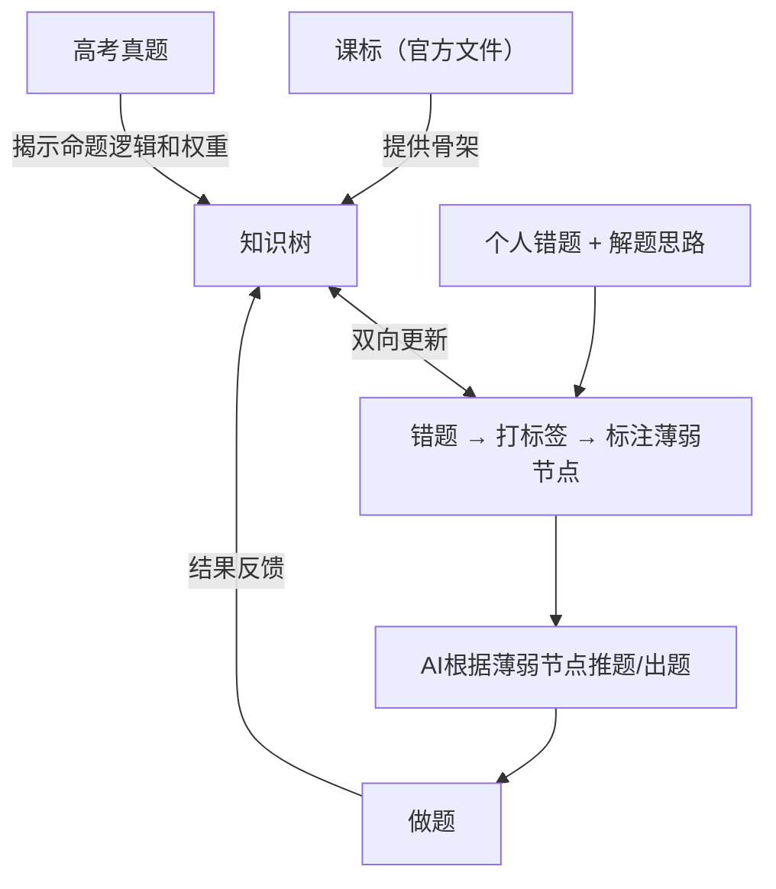
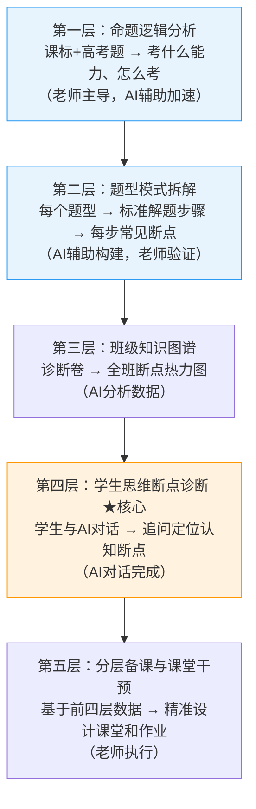

# 把AI用于备考，我是怎么一步步跟AI讨论出来的

上一期聊了把AI用于教学的三个层次——考试层、备课层、学习层。没想到大家反馈这么强烈，所以今天直接切入大家最关心的那个点：备考。

但我想换一种方式来讲这件事。

这期内容，我不是先想好一套方案再讲给大家听的。我是直接对着屏幕，一步一步跟AI讨论出来的。你看到的不只是"AI能怎么用于备考"的结论，而是我从一个模糊的想法出发，怎么通过跟AI对话，把思路一层层推深的完整过程。我觉得这个过程本身，可能比结论更有价值。因为它展示的是一种工作方式——你不需要先想清楚再去用AI，你可以带着问题直接跟它聊，在讨论中把事情想清楚。

先特别说明，我在备考这个方向上的很多思考，受到了社群里严新老师非常多的启发。他在AI应用于备考这件事上的研究深度，远超我目前做到的。我今天分享的更多是一个方向上的思路，真正落到每个学科每个学段的细节，需要大家自己去实践。

---

## 第一轮：直接问AI，听起来不错，但总觉得差点意思

我做的第一件事，是站在一个高三学生的角度，直接问AI：我想用AI来辅助物理复习，手里有课标、有高考题、有自己的错题，可以怎么做？

AI给的回答其实不差。大思路是：用课标帮你生成一个知识结构，然后把错题喂给AI，让它帮你找薄弱点，再针对薄弱点做练习。它还给了具体的prompt模板，比如怎么把错题连同你的解题过程一起给AI，让AI分析你的思维误区。甚至提醒了一个很关键的点——你一定要把自己的错误思路写进去，AI才能真正分析你的问题，而不是只讲标准解法。

听起来挺有道理的。但总觉得差点意思，还没到AI真正能发挥深度价值的那个层次。

## 第二轮：追问之后，一个关键区分出现了

继续追问，这一轮出来了一个非常重要的区分——课标、高考题、错题，这三样东西不应该混在一起用，它们各自扮演的角色完全不同。

课标提供的是知识的骨架，它定义的是"标准是什么"。高考题揭示的是考点的真实权重和出题逻辑，它回答的是"命题人在考什么、怎么考"。而错题定位的是你个人的思维盲点，它告诉你的是"你这个具体的人，卡在哪里"。

这三者叠加起来，才是一个完整的分析框架。之前第一轮的方案把它们混在一起，所以虽然方向对，但每一步都不够精准。

想清楚这个区分之后，整个系统的逻辑就清晰了：先用课标搭知识树骨架，再用高考题去分析命题逻辑和出题规律，然后错题不只是"我做错了哪道题"，而是要挂到知识树上，标注出你到底在哪个节点薄弱。AI根据你的薄弱节点来推题、出题，做完之后结果再反馈回知识树，更新你的掌握状态。这样就不是一个静态的知识树，而是一个随着你的学习动态更新的活系统。

学生版的整体闭环是这样的：

但这里面又出来了几个很现实的问题。继续追问：搭知识树的时候怎么保证信息源准确？AI分析出题规律到底能准到什么程度？错题拍照给AI，它真的能识别出思维模式吗？

AI的回答很实在。第一，知识树一定要你自己提供课标原文，不要指望AI自己去搜，最好用NotebookLM这类能限定信息源的工具，而且一定要让AI说出它的依据，不确定的地方让它明说，不要让它自信地编。第二，分析出题规律不要直接问"规律是什么"，要分两步——先让AI把题目按考查的核心能力归类，再针对每一类深挖。第三，也是最关键的一个结论：AI能访问到的东西只有两类——你写下来的，和你说出来的。所以你一定要把自己的解题思路告诉AI，这才是诊断的真正原材料。拍个答案给它，它只能给你标准解法，诊断不了你脑子里到底卡在哪。

## 第三轮：换到老师的视角，发现问题变了

学生版的思路理清之后，换一个视角再问：如果是一个高三物理老师，面对一个班四五十个学生，该怎么把AI用于班级的备考？

这一轮讨论一开始，AI就给出了一个判断：学生用AI理解自己，老师用AI理解一个班。同样是备考，视角一变，要解决的问题完全不一样了。老师需要知道的是：哪些是全班共性的薄弱点？哪些学生有个性化的问题？有限的精力到底应该花在哪里？

于是出来了一个五层的架构。

但这个架构里，前两层才是真正的地基。如果这两层做不到位，后面全是虚的。

第一层是命题逻辑分析。这一层老师有天然优势——你理解命题人的意图，AI帮你把这个优势系统化。把近五年的高考真题和课标相关章节一起给AI，让它分析命题人真正在考查什么核心能力、考查角度有什么变化趋势、哪些情境是命题人偏爱的。

第二层是题型模式拆解，这是整个系统的核心工具。传统错题分析的单元是"知识点"——学生不会楞次定律。但这套系统的分析单元是"步骤中的断点"——学生在判断磁通量变化方向这一步断掉了。同样的知识点，不同的断点，需要的干预方式完全不同。你选一个高频题型，把相关高考题全部给AI，让它提炼标准解题步骤模板，分析每一步学生最常见的断点是什么，每个断点背后反映的是什么认知问题。产出的不是答案，而是一张"题型解剖图"。

但这里有一个很重要的提醒：前两层一定是老师带着AI去做，或者说老师和AI讨论着去做。你如果完全交给AI，它很可能给你一些看起来很正确但实际上没什么用的东西。只有你作为专业人士，才能判断AI拆得对不对、深不深。

## 第四轮：追到最深处——发现了一个本质区分

讨论到这里，还有一个地方没打透。AI拆解的一直是"解题步骤"的断点，但解题步骤的断点和学生思维层面的断点，其实是两件不同的事情。

解题步骤的断点是行为层面可以观察到的——学生做到第三步没了，或者第二步算错了。这一层的诊断，现在很多AI工具已经能做到。但思维层面的断点是认知层面的，没办法直接观察到学生脑子里在发生什么。同一个步骤做错了，背后可能是完全不同的原因：可能这个概念从来没有真正理解过，需要重新讲；可能理解过但遗忘了，需要复习巩固；可能单独考会做但放到综合题里就混乱了，需要整合训练；也可能换一个情境就不认识了，需要迁移练习。

这四种情况，干预方式完全不同。如果不区分，只是让学生"多做同类型的题"，效果很有限。因为很多断点不是靠刷题能修复的——概念从未理解，你刷一百道也还是不理解。

那AI怎么做到思维层面的诊断？核心思路是：不让AI给答案，而是让AI向学生提问。学生拿一道错题，说出自己的解题思路，AI通过一系列追问来帮学生自己发现思维卡在哪里。比如学生说"我觉得感应电流方向向右"，AI不说你错了，而是问"你用什么依据判断的方向？"学生说"磁场向左所以电流向右"，AI再追问"楞次定律说的是阻碍什么？是阻碍磁场，还是阻碍磁通量的变化？"——通过这样的追问，学生自己发现自己的思维到底断在哪里。这比直接给答案有效得多。

## 现实检验：一个尖锐的问题

到这里系统看起来已经挺完整了，但继续往下审视，一个很尖锐的问题出来了：能够独立搭起这套系统的学生，本身就是有元认知能力的学生。他们可能根本不是最需要帮助的那一批。真正最需要这套系统的学生，很可能在第一步就放弃了。

所以结论是：不要让学生去"建系统"。系统是后来慢慢长出来的，不是一开始就建好的。起点应该是一件最小的事，摩擦力低到不可能放弃。

还有一个问题：前面花了很大篇幅在诊断上，但诊断完了之后呢？修复这一步其实是空的。多做针对性的题就能修复吗？不一定。不同类型的断点，修法完全不一样：

| 断点类型 | 判断信号 | 修复方式 |
|---------|---------|---------|
| 概念从未真正理解 | AI一问，完全不知道怎么回答 | 先不做题，让AI用反例或类比重新讲这个概念 |
| 概念边界模糊 | 有答案但说不清为什么 | 让AI出一道专门暴露这个误区的题 |
| 工具使用错误 | 每次判断都不确定 | 5道专项练习，做一道反馈一道 |
| 整合时混乱 | 单独会，综合题就乱 | 从最简综合题开始，逐步加难度 |
| 情境迁移障碍 | 熟悉的会，换情境就懵 | 同一原理，换3种不同情境出题 |

---

## 你今天就可以做的事

说了这么多，最后给大家一个可以直接开始的起点。不论你是学生、家长还是老师，不需要搭任何系统，今天就可以做。

### 如果你是学生（或者家长带着孩子做）

**第一步：拿一道最近做错的物理题，打开AI，把这段话发给它：**

> 你是一个物理思维诊断助手。我做错了这道题：[粘贴题目]。我当时的解题思路是：[用自己的话说，哪怕说得很乱也没关系]。请不要告诉我正确答案，先问我几个问题，帮我自己找到我到底卡在哪里。

然后跟着AI的问题走，认真回答它。对话结束时加一句：

> 好，现在告诉我：我的思维断在了哪一步，卡的是什么？修复这个断点，我应该先做什么——是重新理解这个概念，还是直接做练习？

**就这一步。先感受一次，再谈系统。**

**第二步：积累够10道之后。** 每次对话结束，用手机备忘录记下AI给你的诊断总结。积累到10条，把它们一起发给AI："以下是我最近十道错题的诊断总结，帮我找找有没有某种思维习惯在反复出现。"——这就是你的薄弱点地图。

**第三步：针对性修复。** 拿到薄弱点地图后，根据上面那张断点类型表，选择对应的修复方式让AI帮你练。

### 如果你是老师

**第一步：选一个知识模块，先做一次命题逻辑分析。**

把近5年这个模块的高考真题，连同课标里对应章节的原文，一起给AI。让它帮你分析：命题人真正在考查的核心能力是什么（不是知识点，是能力）、这几年考查角度有什么变化趋势、学生最容易被哪类设问方式迷惑。你带着AI一起分析，用你的专业判断去验证和补充。产出一份这个模块的"命题逻辑图谱"。

**第二步：在命题逻辑的基础上，做题型拆解。**

选这个模块里的一个高频题型，把相关高考题全部给AI，让它提炼标准解题步骤模板，分析每一步学生最常见的断点是什么，每个断点背后反映的是什么认知问题。产出一张"题型解剖图"。然后用这张解剖图设计一次诊断测验——不是普通测验，每道题只考查一个步骤的一个断点，不混合考查，15分钟能做完。目的不是打分，是定位全班到底在哪些地方断得最多。

**第三步：让学生开始跟AI做"思维诊断对话"。**

把上面学生版的那段prompt给你的学生，让他们课后拿自己的错题跟AI对话。对话结束后让AI输出一句诊断总结，学生把总结发给你。你收集全班的诊断总结，再打包发给AI："以下是全班学生本次的诊断总结，帮我分析哪种思维断点在全班最普遍，我下节课的备课重点应该放在哪里。"

**这三步不需要一次全做。先从第一步开始，选一个知识模块试一次。**

---

## 说回这期内容本身

最后说一个比具体方法更重要的事。

你会注意到，这整期内容不是我提前想好一套方案讲给大家的。我是直接跟AI对话——先从学生视角问，发现不够深，继续追问，发现三个输入源的角色区分；切到老师视角，发现问题变了，出来了五层架构；再追到思维断点和解题步骤断点的本质区分；最后反过来审视，发现了系统门槛太高和修复环节缺失的问题。每一轮讨论都是在上一轮的基础上再推深一层。

整个过程就是我真实的工作方式。

我录这期视频不是为了给大家一个完美的答案。我想让大家看到的是：跟AI讨论问题这件事本身，就是AI最重要的用法之一。你不需要先有答案再去找AI确认。你可以带着一个半成品的想法直接跟它聊，在对话中逐步推进、逐步深入，然后在讨论中发现你自己原本没想到的东西。

备考是这样，备课是这样，其实很多工作都是这样。

详细的教师版系统设计、学生版操作指南和极简版入门方案，我都整理好了，大家可以在后台回复"备考"获取。但我真正希望你带走的不只是那些文档，而是你看完这篇之后，自己打开一个AI，带着你手头正在琢磨的某个问题，跟它聊一次。看看能聊到什么程度。

---

*这期内容中关于AI应用于备考的很多深度思考，受到严新老师的启发。他在这个方向上的实践远比我深入，接下来我也会邀请他做更具体的、深入到学科层面的分享。*

*如果你实践了这个思路，欢迎回来告诉我你是怎么做的，以及取得了什么效果。*
