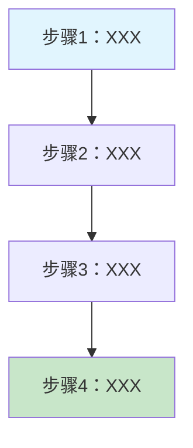
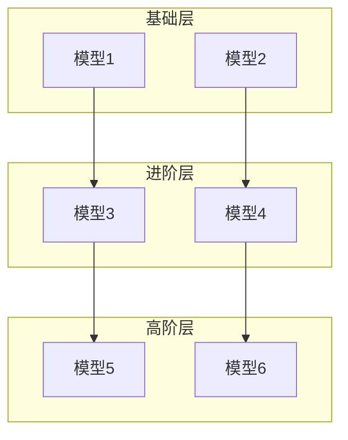
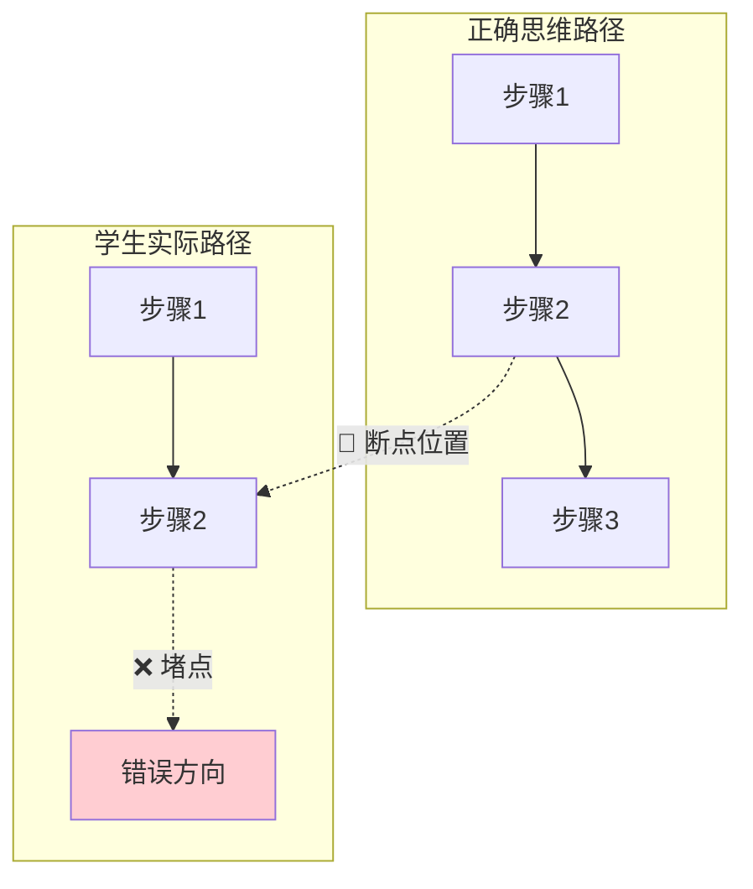
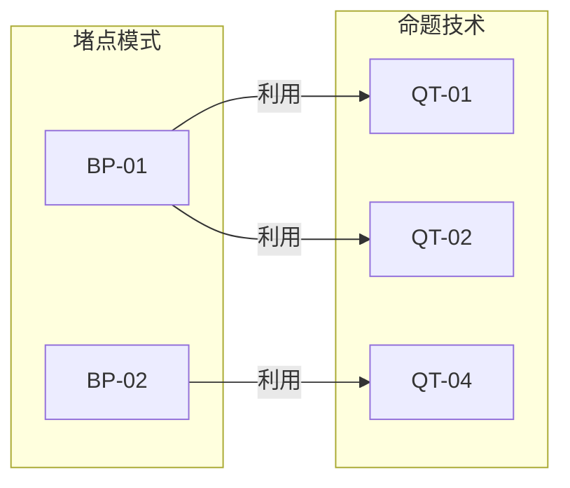

# 能力点标注专家完整工作流程（整合版）

> **版本**：v2.5（修正维度体系、新增同步分析、完善评分纪律）
> **更新日期**：2026年2月13日
> **更新说明**：
>
> - v2.0：补充Step 9-10、数据库操作、实事求是六步法、思维模型匹配算法
> - v2.1：补充Stage D详细结构（D1-D4子步骤）、Stage B-C执行步骤、Step 7质量自查详细内容、Step 8进度提示规则、清理对话痕迹
> - v2.2：补充Step 10.6完整报告模板、报告与现有体系的关系说明
> - v2.3：补充Step 10.7可视化报告生成（思维模型流程图、堵点模式流程图）
> - v2.4：补充Stage 0环节2.4三维立体标注8步流程（与stage0-section2-3d-annotation.execution.md对齐）
> - v2.5：修正维度体系（六大素养维度）、新增Stage E同步分析、完善评分纪律、强化Stage D依赖约束

---

> **文档定位**：本文档是 `annotation-workflow`（标注工作流）的详细说明，
> 它是 `ability-point-coach` 角色的核心执行流程之一。
> 完整角色架构见 `能力点系统化/能力点标注专家-角色架构说明.md`

---

## ⚠️ 执行前必读：强制执行清单

### 🔒 每道题标注时必须按顺序勾选

**使用方法**：

1. 每次标注新题时，先用TaskCreate创建此清单
2. 完成一步就用TaskUpdate标记为completed
3. 未完成不进入下一步

**完整清单**：

```
□ Step 1: 任务接收（确认题号、试卷、题目总数）
□ Step 2: Stage 0 - 官方解析研读
  □ 2.1 考查目标原文摘录
  □ 2.2 试题解析原文摘录
  □ 2.3 能力要求关键句提炼（必须查询知识库）
  □ 2.4 解题思维过程提炼 - 三维立体标注 ⭐核心环节
    □ 步骤1-4：提取思维步骤→识别能力动词→判定水平→归类维度
    □ 步骤5：查询编码（必须查询v1.1数据库）
    □ 步骤6-7：完成三维标注格式→环节汇总
    □ 步骤8：质量检查清单（8项自查）
□ Step 3: Stage A - 能力全面识别
  □ ✅ 标注前自查3问（必读typical-errors-and-principles.knowledge.md）
  □ ✅ 应用四元区分法（区分WHAT/HOW/WITH WHAT/TO WHAT EXTENT）
  □ ⚠️ 能力点数量≥7个时检查过度拆分
□ Step 4: Stage B-C - 维度定位与题点匹配
□ Step 5: Stage D - 思维路径梳理
  □ D.4 思维堵点分析（≥3个能力点时执行）
  □ D.5 思维模型识别（≥4个能力点时执行）
□ Step 6: Stage E - 正式标注输出
  □ 标准格式标注表
  □ 同步分析（干扰选项分析、题点组合记录、官方解析关键词、思维路径模板）
□ Step 7: 质量自查
  □ ✅ 标注后自查5问
□ Step 8: 格式化输出
□ Step 5.6: 堵点分析（如触发）
  □ 5.6.1 快速判断（30秒）
  □ 5.6.2 完整堵点分析
    □ ✅ 三条件验证表（透明化判断）
    □ ✅ 判断流程表（不能只给结果）
    □ ⚠️ 匹配度<70%触发红线（提出新编码）
  □ 5.6.3 数据库写入（必须执行）
□ Line 2专项标注（如执行了堵点分析）
  □ Line 2-A: 命题技术编码标注
  □ Line 2-B: 堵点模式编码标注
  □ Line 2-C: 本质规律验证记录
  □ Line 2-D: 标注质量自查
□ 六维质量诊断
  □ 1. 能力考查有效性
  □ 2. 材料选择恰当性
  □ 3. 干扰项设置合理性
  □ 4. 思维路径清晰性
  □ 5. 堵点分析准确性
  □ 6. 教学指导价值
  □ 综合评价（总体评分+评级）
□ Step 9: 数据记录与知识库同步（标完全部题目后触发）
  □ 9.1 汇总新能力点发现（三条件验证表）
  □ 9.2 同步命令提示（一键同步工具）
  □ 9.3 用户操作确认
  □ 9.4 检查清单（AI任务+用户任务）
  □ 9.5 后续验证流程
□ Step 10: 统计分析与规律复盘（标完全部题目后触发）
  □ 10.1 命题技术合规率统计
  □ 10.2 堵点模式验证统计
  □ 10.3 本质规律验证记录
  □ 10.4 新能力点使用统计
  □ 10.5 新发现总结（Line 2堵点分析）
    □ 10.5.1 新QT/BP发现的三条件验证
  □ 10.6 知识库更新决策（三步流程）
  □ 10.6 复盘总结报告生成
  □ 10.7 可视化报告生成
    □ 10.7.1 思维模型流程图报告
    □ 10.7.2 堵点模式流程图报告
  □ 10.8 检查清单
```

**关键防护点**：

- ⚠️ Stage A必须先读typical-errors-and-principles.knowledge.md
- ⚠️ Step 5.6必须先读bottleneck-analysis.execution.md
- ⚠️ 能力点必须查询v1.1.md数据库
- ⚠️ QT/BP必须三条件验证，填写判断流程表
- ⚠️ Step 5.6.3数据库写入不可跳过

---

## 方法论基础："实事求是"六步法

### 核心思想

"实事求是"是能力点标注工作的根本方法论：

- **实事**：真题是检验理论的"实事"
- **求是**："是"即规律、真理、完整的能力体系
- **实事求是**：在实践中发现真理，用真理指导实践

### 完整流程（六步法 - 2026年升级）

```
┌─────────────────────────────────────────────────────────┐
│ Step 1: 理论准备 - 掌握课标理论体系                     │
│  - 学习课标，理解每个题点和微题点的内涵                 │
│  - 建立理论框架，形成初始知识库（v1.0）                 │
└─────────────────────────────────────────────────────────┘
                          ↓
┌─────────────────────────────────────────────────────────┐
│ Step 2: 实践检验 - 用真题验证理论完整性（单省卷）        │
│  - 选取真题样本（如2025山东卷）                         │
│  - 逐题标注能力点                                       │
│  - 记录标注过程中的困难和疑问                           │
└─────────────────────────────────────────────────────────┘
                          ↓
┌─────────────────────────────────────────────────────────┐
│ Step 3: 发现缺失 - 识别课标未覆盖的能力点               │
│  - 标注困难1：某能力在真题中高频出现，但课标没有明确微题点│
│  - 标注困难2：某题考查的能力，课标的应用说明太模糊       │
│  - 标注困难3：真题考查角度与课标描述存在偏差             │
└─────────────────────────────────────────────────────────┘
                          ↓
┌─────────────────────────────────────────────────────────┐
│ Step 4: 数据支撑 - 收集单省实证数据                     │
│  - 统计该能力点的出现频率（如7/11题）                   │
│  - 记录具体题号（如第2、3、5、6、9、10、11题）          │
│  - 分析能力点的考查特征（如何考、考什么）               │
└─────────────────────────────────────────────────────────┘
                          ↓
┌─────────────────────────────────────────────────────────┐
│ Step 4.5: 多省验证与分类判断 ← 2026年新增               │
│  ⚠️ 重要：发现潜在扩展点后，不要立即扩展！              │
│  ─────────────────────────────────────────────────────  │
│  阶段1: 数据收集 - 收集≥3个其他省份的同年度高考卷       │
│  阶段2: 跨省标注 - 用现有知识库标注各省份试卷           │
│  阶段3: 跨省统计 - 统计跨省平均频率、省份覆盖度         │
│  阶段4: 分类判断 - 应用判断矩阵（四维度评分）           │
│    ✓ 类型A：课标普遍缺失（通用扩展）                    │
│    ✓ 类型B：省份命题偏好（特色扩展）                    │
│    ✓ 类型C：偶然出现（暂不扩展）                        │
└─────────────────────────────────────────────────────────┘
                          ↓
┌─────────────────────────────────────────────────────────┐
│ Step 5: 分类扩展 - 规范化扩展知识库（标注适用范围）      │
│  类型A：标注【扩展内容 vX.X - 通用】                    │
│  类型B：标注【扩展内容 vX.X - XX省特色】                │
│  类型C：不扩展，保留记录等待后续验证                    │
└─────────────────────────────────────────────────────────┘
                          ↓
              理论更完善 → 继续新的实践检验
```

### 判断"缺失"的四个标准

一个能力点被视为"缺失"，需要同时满足：

| 判断维度      | 标准                                                 |
| ------------- | ---------------------------------------------------- |
| 1. 高频出现   | 在样本中出现频率 ≥ 20%（如11题中≥2题）             |
| 2. 课标模糊   | 课标对此能力的描述模糊、宽泛，或仅在"应用说明"中提及 |
| 3. 可操作性差 | 无法直接用于标注和评价，需要进一步分解               |
| 4. 独立性强   | 该能力点不能被现有微题点完全覆盖                     |

---

## 总体流程图

### 单题标注流程（Step 1-8）

```
┌─────────────────────────────────────────────────────────────────────────┐
│                        能力点标注专家完整工作流程                          │
├─────────────────────────────────────────────────────────────────────────┤
│                                                                         │
│  Step 1 ──→ Stage 0 ──→ Stage A ──→ Stage B-C ──→ Stage D ──→          │
│  任务接收    官方解析    能力全面     维度定位      思维路径              │
│             研读        识别         题点匹配      梳理                  │
│                                                                         │
│                    ┌──────────────────────────────┐                     │
│                    │  能力点≥3个？                │                     │
│                    │  是 → Stage D.4（堵点分析）  │                     │
│                    │  否 → 跳过                   │                     │
│                    └──────────────────────────────┘                     │
│                              ↓                                          │
│                    ┌──────────────────────────────┐                     │
│                    │  能力点≥4个？                │                     │
│                    │  是 → Stage D.5（思维模型）  │                     │
│                    │  否 → 跳过                   │                     │
│                    └──────────────────────────────┘                     │
│                              ↓                                          │
│  ──→ Stage E ──→ Line 2专项标注 ──→ 六维质量诊断 ──→ Step 8格式化输出   │
│      正式标注     (A/B/C/D四部分)                                        │
│      输出                                                               │
└─────────────────────────────────────────────────────────────────────────┘
```

### 整套试卷闭环流程（Step 9-10）

```
┌─────────────────────────────────────────────────────────────────────────┐
│                        整套试卷完成后的闭环流程                           │
├─────────────────────────────────────────────────────────────────────────┤
│                                                                         │
│  标注第N题完成                                                           │
│       ↓                                                                 │
│  检查：已标注题数(N) == 总题数？                                         │
│       ├─ 否 → 继续等待下一题                                            │
│       └─ 是 → 🎉 全部完成 → 自动进入Step 9                              │
│                    ↓                                                    │
│  ┌─────────────────────────────────────────────────────────────────┐   │
│  │ Step 9: 数据记录与知识库同步                                     │   │
│  │  9.1 汇总新能力点发现（三条件验证）                              │   │
│  │  9.2 同步命令提示                                                │   │
│  │  9.3 用户操作指引                                                │   │
│  │  9.4 检查清单                                                    │   │
│  │  9.5 后续验证流程                                                │   │
│  └─────────────────────────────────────────────────────────────────┘   │
│                    ↓                                                    │
│  ┌─────────────────────────────────────────────────────────────────┐   │
│  │ Step 10: 统计分析与规律复盘                                      │   │
│  │  10.1 命题技术合规率统计                                         │   │
│  │  10.2 堵点模式验证统计                                           │   │
│  │  10.3 本质规律验证记录                                           │   │
│  │  10.4 新能力点使用统计                                           │   │
│  │  10.5 新发现总结（Line 2堵点分析）                               │   │
│  │  10.5.1 新QT/BP发现的三条件验证                                  │   │
│  │  10.6 知识库更新决策 + 复盘报告生成                              │   │
│  │  10.7 检查清单                                                   │   │
│  └─────────────────────────────────────────────────────────────────┘   │
│                    ↓                                                    │
│  完成闭环 → 知识库更新 → 数据库同步 → 准备下一套试卷                    │
└─────────────────────────────────────────────────────────────────────────┘
```

---

## 第一阶段：Stage 0 - 官方解析研读

### 1.1 必须包含的子模块

1. 【考查目标原文摘录】 - 完整摘录
2. 【试题解析原文摘录】 - 完整摘录
3. 【能力要求关键句提炼】 - 逐句四元分析
4. 【解题思维过程提炼】 - 思维步骤

### 1.2 关键句提炼标准格式（每句必须包含）

  **关键句X**："[原文]"

  **四元分析**：

- **WHAT（做什么）**："[能力点]" → ✅ 独立能力点
- **HOW（怎么做）**：[方法] → ❌ 方法要求，融入WHAT
- **WITH WHAT（用什么）**："[史料]" → 史料支撑
- **TO WHAT EXTENT（到什么程度）**："[程度词]" → 程度要求，融入WHAT

  **数据库匹配**：
- 查询关键词：[关键词列表]
- ⚠️ 初步判断：[判断说明]
- 可能匹配：题点X.X [名称]

  - 微题点X.X.X [名称]
- **暂时标注**：[编码或"待数据库核查"]

  **初步判断**：（第6题补充格式）
- 能力点类型：WHAT（独立能力点）
- 查询知识库：搜索"[关键词1]"、"[关键词2]"
- 匹配结果：题点X.X [名称] → 微题点X.X.X
- **标注**：X.X.X [名称]
- **程度融入**："[程度词]"[说明]

### 1.3 四元区分判断标准

  ┌────────────────┬────────────────────────────────┬────────────────────┐
  │      元素      │            判断标准            │      标注方式      │
  ├────────────────┼────────────────────────────────┼────────────────────┤
  │ WHAT           │ 能独立成为能力点的动作         │ ✅ 独立能力点      │
  ├────────────────┼────────────────────────────────┼────────────────────┤
  │ HOW            │ 完成WHAT的方法/方式            │ ❌ 融入WHAT        │
  ├────────────────┼────────────────────────────────┼────────────────────┤
  │ WITH WHAT      │ 史料支撑/前置知识/对象         │ 不标注为独立能力点 │
  ├────────────────┼────────────────────────────────┼────────────────────┤
  │ TO WHAT EXTENT │ 程度副词（准确、核心、特定等） │ 程度要求，融入WHAT │
  └────────────────┴────────────────────────────────┴────────────────────┘
  核心原则：只有WHAT才能标注为独立能力点！

### 1.4 解题思维过程提炼 - 三维立体标注（5-8分钟）⭐核心环节

**定位说明**：

- **适用时机**：在Stage 0中，完成2.1-2.3环节后执行
- **方法论**：三维立体标注（能力动词 + 水平层级 + 素养维度 + 编码查询）
- **核心产出**：带编码的思维步骤标注

**与Stage D的区别**：

- **Stage 0（2.4）**：基于官方解析的思维步骤，进行三维标注（能力动词+水平+维度+编码）
- **Stage D**：基于已确定的能力点，梳理学生视角的思维路径（能力点→思维操作的映射）

#### 步骤1：提取思维步骤（从官方解析）

**在哪里找？**

- 【试题解析】部分（即2.2摘录的内容）
- 寻找表示"步骤"的关键句式

**关键句式**：

```
"解答本题的关键是..."
"首先...其次...再次..."
"需要...然后...最后..."
"从...可以看出..."
"据此可知..."
```

**格式要求**：

- 用引号标注官方解析原文
- 保持原文语序
- 一句话一个步骤

**输出示例**：

```markdown
**思维步骤1**: "准确理解'商业'的概念及其'已有较高程度发展'的内涵"
**思维步骤2**: "正确理解商业和货币的关系"
**思维步骤3**: "青铜币和包金币等铸币的使用是当时商业活动已有较高程度发展的表现"
```

#### 步骤2：识别能力动词

**能力动词速查表**：

```
水平1类：识别、判断、提取、定位、回忆、说明、辨识
水平2类：比较、综合、关联、概括、归纳、建立
水平3类：阐释、评价、运用、论证、说明、认识
水平4类：探究、质疑、创新、批判
```

**操作**：

- 从思维步骤中提取核心动词
- 如果原文没有动词，根据含义补充

**示例**：

```
"准确理解'商业'的概念..." → 能力动词：理解/辨识
"正确理解商业和货币的关系" → 能力动词：建立关联
"识别四个选项中的器物类型" → 能力动词：识别
```

#### 步骤3：判定水平层级

**水平判定速查表**：

```
水平1（基础认知）→ 识别、判断、提取、回忆
水平2（综合分析）→ 比较、综合、关联、概括
水平3（高阶思维）→ 阐释、评价、运用理论、认识演进过程
水平4（创新探究）→ 探究、质疑、创新
```

**判定原则**：

- 单一信息操作 → 水平1
- 多信息整合 → 水平2
- 理论运用/深层分析 → 水平3
- 独立探究/批判 → 水平4

#### 步骤4：归类素养维度

**素养维度速查表**：

```
时空观念 → 时间、空间、演变、历史进程
史料实证 → 史料、解读、提取、辨识
历史解释 → 因果、关联、比较、综合
唯物史观 → 生产力、经济基础、阶级、社会形态
家国情怀 → 认同、情感、责任
独立探究 → 探究、质疑、论证
```

**归类原则**：

- 看关键词
- 选主要维度
- 如有疑问，选"历史解释"（最常见）

#### 步骤5：查询编码（关键！）

**查询流程**：

```
1. 根据水平层级（1/2/3/4），定位到对应章节
2. 根据素养维度，定位到对应题点
3. 根据能力动词，找到对应微题点编码
```

**两种结果**：

**结果A：找到匹配编码**

```markdown
- 编码：1.3.1 辨识重要历史现象的核心要素
- 依据：《课程标准（2025版）》水平1要求
- 来源：✅ 题点-微题点数据库v1.1
```

**结果B：未找到匹配编码**（实事求是原则）

```markdown
- 编码：[待定-逻辑辨析能力]
- 来源：⚠️ 数据库未覆盖，本题新发现
- 建议归类：题点2.X的潜在扩展
- 出现题号：2025山东卷第X题
```

#### 步骤6：完成三维标注格式

**标准格式**：

```markdown
**思维步骤X**: "官方解析原文（用引号）"
→ 提示：需要【能力动词】（水平X-素养维度）
   - 编码：X.X.X 能力点名称
   - 依据：《课程标准（2025版）》水平X要求
   - 来源：✅ 题点-微题点数据库v1.1
```

**完整示例**：

```markdown
**思维步骤1**: "准确理解'商业'的概念及其'已有较高程度发展'的内涵"
→ 提示：需要辨识重要历史现象的核心要素（水平1-史料维度）
   - 编码：1.3.1 辨识重要历史人物、事件、现象的核心要素
   - 依据：《课程标准（2025版）》水平1，题点1.3
   - 来源：✅ 题点-微题点数据库v1.1

**思维步骤2**: "正确理解商业和货币的关系"
→ 提示：需要建立不同历史现象之间的关联（水平2-历史解释维度）
   - 编码：2.7.1 建立史事间的因果联系
   - 依据：《课程标准（2025版）》水平2，题点2.7
   - 来源：✅ 题点-微题点数据库v1.1
```

#### 步骤7：完成环节汇总

**汇总格式**：

```markdown
### ✅ Stage 0-环节2.4 完成汇总

**思维步骤数量**：X个

**能力点匹配情况**：
- ✅ 已匹配能力点（X个）：1.3.1, 2.4.1, 3.3.1
  - 来源：题点-微题点数据库v1.1

- ⚠️ 未匹配能力点（X个）：
  - [待定-逻辑辨析能力]（出现在思维步骤X）
  - 说明：数据库暂无对应编码，标记为新发现

**水平分布**：
- 水平1：X个步骤
- 水平2：X个步骤
- 水平3：X个步骤

**下一步**：进入Stage A全面识别
```

#### 步骤8：质量检查清单

完成环节2.4后，必须自查：

- [ ] 每个思维步骤都用引号标注了官方解析原文？
- [ ] 每个步骤都标注了"能力动词+水平+维度"？
- [ ] 每个编码都查询了数据库v1.1？
- [ ] 未匹配的能力点标记了"⚠️新发现"？
- [ ] 水平递进合理（通常从低到高）？
- [ ] 完成了环节汇总？

---

## 第二阶段：Stage A - 能力全面识别

#### 2.1 必须完成的自查问题

#### ✅ 自查第1问：我是否先读了官方解析原文？

  答：✅ 是的，已完整摘录考查目标和试题解析原文。

#### ✅ 自查第2问：我是否区分了WHAT vs HOW vs WITH WHAT vs TO WHAT EXTENT？

  答：✅ 是的，在Stage 0的关键句提炼中已逐句进行四元分析。

#### ✅ 自查第3问：我是否避免"数据库有什么就匹配什么"的削足适履？

  答：✅ 是的，现在开始严格对照数据库v1.1进行编码验证。

#### 2.2 数据库编码验证格式

  **能力点X：[能力点名称]**

- 官方解析："[原文引用]"
- 数据库查询：题点X.X [名称]
  - 微题点X.X.X [名称]（第XXX-XXX行）
    - [数据库定义摘录]
- **标注**：✅ X.X.X [名称]（水平X-[维度]）
- **程度融入**："[程度词]"[说明]

#### 2.3 数据库缺失的标注方式

  **能力点X：[能力点名称]**

- 官方解析："[原文引用]"
- 数据库查询：
  - ⚠ 数据库中没有明确的"[能力描述]"的微题点
  - 可能相关：题点X.X [名称]（第XXX行）
- **判断**：这个能力点在数据库v1.1中**没有明确对应的编码**
- **标注**：⚠️ **数据库缺失**（建议新增：[具体建议]）

#### 2.4 最终能力点确认格式

#### 最终能力点确认

  经过严格的数据库核查，本题考查的能力点为：

1. **X.X.X [名称]**（水平X-[维度]）

   - [具体说明]
   - [包含的融入要素]
2. **数据库缺失：[能力点名称]**

   - 数据库v1.1中没有对应编码

  **能力点总数**：X个（数据库已有）+ X个（数据库缺失）= X个

---

### 第三阶段：Stage B-C - 维度定位与题点匹配

**执行步骤**：

1. 将Stage A的能力点归类到素养维度
2. 在每个维度下精确匹配能力点编码体系
3. 验证水平层级（水平1-4）
4. 筛选核心能力点（通常3-6个）

**素养维度**（与课标一致）：

- 唯物史观维度
- 时空观念维度
- 史料实证维度
- 历史解释维度
- 家国情怀维度
- 综合能力维度

> ⚠️ 注意：涉及多维度交叉的能力点，按其主要认知动作归入最匹配的维度，在标注中注明跨维度特征。

---

### 第四阶段：Stage D - 思维路径梳理

**前置依赖**：

- ✅ 必须先完成Stage B-C，获得确定的能力点编码列表
- ✅ Stage D使用的所有能力点编码**必须来自Stage B-C的输出**
- ❌ 不允许在Stage D中引入新的能力点编码

**Stage D的任务**：

1. 将Stage B-C确定的能力点按照解题的逻辑顺序排列
2. 说明每个能力点对应的具体思维操作
3. 建立能力点之间的逻辑关系（上一步的输出→下一步的输入）

**总时长**：2-3分钟

---

#### D1：学生视角初次审题（20秒）

**目的**：从学生角度思考"拿到题目的第一反应"

**操作**：

- 学生看到题目后，会先做什么？（读材料、看问题、看选项？）
- 初步判断题目类型（时序题、因果题、比较题、综合题？）
- 预估解题难度（需要几步思维操作？）

**输出格式**：

```markdown
#### 【学生初次审题】
- 题目类型：（时序题/因果题/比较题/综合题等）
- 第一反应：（学生会先做什么）
- 预估难度：（简单/中等/困难，需要X步思维操作）
```

---

#### D2：逐步梳理思维链条（60-90秒）⭐ **核心环节**

**目的**：建立"能力点→思维操作→输出结果"的完整链条

**操作**：

- 使用**Stage B-C确定的能力点编码**，按解题顺序逐一展开
- 每一步明确三个要素：
  1. **能力点编码**（来自Stage B-C）
  2. **具体思维操作**（学生要做什么）
  3. **输出结果**（这一步产生什么，供下一步使用）

**输出格式**：

```markdown
#### 【思维链条梳理】

**步骤1**：[能力点编码] 能力点名称
- 思维操作：（描述学生在这一步要做什么具体操作）
- 输出结果：（这一步产生什么结果，供下一步使用）
  ↓（作为下一步的输入）

**步骤2**：[能力点编码] 能力点名称
- 思维操作：（描述学生在这一步要做什么具体操作）
- 输出结果：（这一步产生什么结果，供下一步使用）
  ↓（作为下一步的输入）

...（根据Stage B-C确定的能力点数量继续）

**能力点来源验证**：
- 使用的编码：（列出所有使用的编码，如：1.1.1, 1.3.2, 2.6.2）
- 来源确认：✅ 全部来自Stage B-C输出
```

**关键提醒**：

- ⚠️ 如果发现思维链条中缺少某个关键步骤，应**返回Stage B-C补充能力点**
- ⚠️ 不要在Stage D中临时创造新的能力点编码

---

#### D3：识别关键转换节点（30秒）

**目的**：找出解题过程中的"坎"（学生容易出错的地方）

**操作**：

- 分析思维链条，找出哪个步骤是"转换点"（能力水平跳跃、思维方式转变）
- 预判学生可能在哪里卡住
- 为后续堵点分析（Stage D.4）做准备

**输出格式**：

```markdown
#### 【关键转换节点】

**主要转换点**：步骤X → 步骤Y
- 转换特征：从"（前一步能力类型）"（水平?）→"（后一步能力类型）"（水平?）
- 难点原因：（分析为什么这个转换困难）
- 预判堵点：（学生可能在这里出现什么问题）

**次要转换点**：步骤A → 步骤B（如有）
- 转换特征：从"（前一步能力类型）"（水平?）→"（后一步能力类型）"（水平?）
- 难点原因：（分析为什么这个转换困难）
```

**关键提醒**：

- ⚠️ 不是每道题都有明显的转换点，如果能力点都在同一水平，可以标注"无明显转换点"
- ⚠️ 转换点通常出现在水平层级跳跃的地方（水平1→2、水平2→3等）

---

#### D4：Stage D输出汇总（自动生成）

**输出格式**：

```markdown
### ✅ Stage D 完成汇总

#### 思维链条完整性
- 总步骤数：X步
- 能力点数量：X个（列出所有编码，如：1.1.1, 1.3.2, ...）
- 来源验证：✅ 全部来自Stage B-C

#### 逻辑连贯性
- 起点能力：（第一个能力点编码及名称）（水平?-X维度）
- 核心能力：（核心能力点编码及名称）（水平?-X维度）
- 终点能力：（最后一个能力点编码及名称）（水平?-X维度）
- 水平递进：（描述水平变化，如：水平1→水平2→水平3，或"无明显递进"）

#### 关键转换节点
- 主要转换：（如：步骤X→步骤Y，能力类型变化）
- 预判堵点：（学生可能的困难点）

#### 下一步
- 进入Stage E，正式输出标注结果
- 如题目≥3个能力点，进入Stage D.4堵点分析（参考上述转换节点）
```

---

**Stage D关键原则总结**：

1. **严格依赖原则**：Stage D使用的所有能力点编码必须来自Stage B-C，不允许临时创造
2. **三要素完整性**：每一步必须包含能力点编码+思维操作+输出结果
3. **逻辑连贯性**：上一步的输出=下一步的输入，形成完整思维链条
4. **学生视角原则**：按照学生解题的自然顺序，不是按编码顺序或专家分析顺序

**与Stage 0（2.4）的区别**：

- Stage 0（2.4）：基于官方解析的解题步骤摘要（粗略版）
- Stage D：基于能力点的思维路径详细梳理（精细版+能力点映射）

**常见错误示范**：

- ❌ 在Stage D中引入Stage B-C没有的编码
- ❌ 只列编码，不说明具体思维操作
- ❌ 思维步骤逻辑不连贯，跳跃过大
- ❌ 发现遗漏能力点时不返回Stage B-C补充

**正确做法示范**：

- ✅ 严格使用Stage B-C确定的编码
- ✅ 每步都包含三要素（编码+操作+输出）
- ✅ 建立清晰的输入输出关系
- ✅ 发现遗漏时返回Stage B-C补充后再继续

---

### 第五阶段：Stage D.4 - 思维堵点分析

#### 5.1 触发条件

  能力点数量 ≥ 3个 → 必须完成Stage D.4（D.4.1-D.4.7）

  5.2 D.4.1 快速判断（30秒）

### D.4.1 快速判断（30秒）

  **步骤1：能力点检查（10秒）**

- ☑ ≥3个能力点（本题X个）→ 继续步骤2

  **步骤2：干扰选项检查（20秒）**

| 选项 | 知识点        | 情境/时空/因果 | 类型判断          |
| ---- | ------------- | -------------- | ----------------- |
| A    | ☑正确/☑错误 | ☑错误/-       | 情境错误/知识错误 |
| B    | ...           | ...            | ...               |

  **最终判断**：

- ☑ 有"知识正确+情境错误"（X选项）→ **复杂题** → 继续D.4.2

  5.3 D.4.2 定位主堵点（2分钟）

### D.4.2 定位主堵点（2分钟）

#### 2.1 回顾思维路径

  步骤1：[能力点1]────┐
                      │
  步骤2：[能力点2]────┼── 步骤X→Y过渡最难
                      │
  步骤3：[能力点3]────┘

#### 2.2 识别堵点位置

  **信号词检查**（官方解析中）：

- ☑ "关键是..." → "[原文引用]"
- ☑ "准确把握..." → "[原文引用]"

  **堵点位置判断**：
- ☑ 步骤X → 步骤Y 的**过渡节点**
- ☑ 单维度→多维度的**转换点**

#### 2.3 学生行为分析

  **学生会做什么**（✓）：

- [列举学生能做到的]

  **学生不会做什么**（✗）：
- [列举学生做不到的]

  **核心缺失**：
- [总结核心缺失的能力]

  5.4 D.4.3 干扰选项断点映射（必须输出表格）

### D.4.3 干扰选项断点映射（2分钟）

#### 映射表格（必须输出）

| 选项 | 错误类型 | 断点位置 | 缺失能力点   | 误选原因   |
| ---- | -------- | -------- | ------------ | ---------- |
| A    | 情境错误 | 步骤X→Y | X.X.X [名称] | [详细说明] |
| B    | 知识错误 | 步骤X    | X.X.X [名称] | [详细说明] |

#### 映射逻辑验证

  ☑ 每个干扰项都有明确的断点位置
  ☑ 断点位置与缺失能力点逻辑一致
  ☑ 误选原因有官方解析支撑

  5.5 D.4.4 识别命题技术（三条件验证表必须输出）

### D.4.4 识别命题技术（3分钟）

#### 4.1 读取最新QT定义

  已读取外部数据文件：`思维堵点与命题技术库_v0.2.md`

#### 4.2 三条件验证（必须输出）

| QT编码 | 条件1:技术本质 | 条件2:设计方法 | 条件3:实证案例 | 匹配度 | 结论           |
| ------ | -------------- | -------------- | -------------- | ------ | -------------- |
| QT-01  | ❌ [说明]      | ❌ [说明]      | ❌ 无匹配      | 20%    | 不用           |
| QT-04  | ✅ [说明]      | ✅ [说明]      | ✅ [选项]      | 90%    | **使用** |

#### 4.3 红线检查

  ☑ 有QT匹配度≥90%（QT-XX: XX%）→ 使用QT-XX → 继续D.4.5

  **确认使用的命题技术**：

- **QT-XX**（XX%）：[技术名称] - [说明]

  红线机制：QT匹配度<90%不能强行使用！

  5.6 D.4.5-D.4.7

### D.4.5 规律验证与新发现（1分钟）

#### 5.1 已有规律验证

  **BP-XX-R1 - [规律名称]**

- ☑ ✅ 验证通过
- 证据：[具体证据]

#### 5.2 新发现记录

  **新堵点模式？**

- ☑ 是，发现新模式：**BP-XX [名称]**
  - 状态：⚠️ 待验证（需≥3题确认）

---

### D.4.6 质量自查（30秒）

- [X] **证据充分性**
- [X] **逻辑一致性**
- [X] **三条件验证**
- [X] **红线机制**
- [X] **新发现标注**

---

### D.4.7 堵点分析总结

  **主堵点**：**BP-XX [名称]**

  **堵点表现**：

1. [表现1]
2. [表现2]

  **次要堵点**：

- **BP-XX** [名称]（导致选X）

  **使用的命题技术**：
- **QT-XX**（XX%）：[技术名称]

  **规律验证**：
- BP-XX-R1（[规律名称]）：✅ 验证通过

---

  第六阶段：Stage D.5 - 思维模型识别（条件触发）

  6.1 触发条件

  能力点数量 ≥ 4个 → 触发思维模型识别

  6.2 完整结构

### Stage D.5：思维模型识别

**触发条件判断**：

- 本题能力点数量：X个（≥4个，触发思维模型识别）

#### 思维模型识别四步法

**Step 1: 查询数据库获取当前模型库（5秒）**

```bash
python -c "from query_helper import GaokaoDBHelper; h = GaokaoDBHelper(); h.get_thinking_models(); h.close()"
```

**Step 2: 提取题目的能力点组合序列（10秒）**

- 按水平层级排序：水平1 → 水平2 → 水平3 → 水平4
- 提取核心能力点（4-6个）
- 形成能力链条描述

**Step 3: 模型匹配算法（15秒）**

**匹配公式**：

```
匹配度 = 重合率 × 0.5 + 链条一致性 × 0.3 + 场景匹配 × 0.2
```

| 计算项     | 公式                                                  | 说明                         |
| ---------- | ----------------------------------------------------- | ---------------------------- |
| 重合率     | \|题目能力点 ∩ 模型核心能力点\| / \|模型核心能力点\| | 能力点交集比例               |
| 链条一致性 | 顺序一致=1.0，顺序不一致=0.6                          | 能力点出现顺序是否与模型一致 |
| 场景匹配   | 匹配的场景特征数 / 总场景特征数                       | 题型、难度等特征匹配         |

**匹配判定标准**：

- 匹配度 ≥ 0.8 → **强匹配**，直接标注为该模型
- 0.6 ≤ 匹配度 < 0.8 → **弱匹配**，标注为"模型M0X的变体"
- 匹配度 < 0.6 → **不匹配**，标记为"潜在新模型"

**Step 4: 识别结果输出（5秒）**

#### 思维模型的四大识别标准

| 标准          | 定义                   | 量化要求                             |
| ------------- | ---------------------- | ------------------------------------ |
| 1. 高频出现性 | 相同能力点组合反复出现 | ≥3次初步认定，≥5次确认为稳定模型   |
| 2. 逻辑完整性 | 形成完整思维链条       | 有起点、推理、终点能力，前后依赖清晰 |
| 3. 跨水平性   | 跨越多个水平层级       | 至少跨2个层级（水平1→2或更多）      |
| 4. 素养融合性 | 融合多个核心素养维度   | 维度数≥3为多维模型（核心模型特征）  |

#### 输出格式

**能力点组合分析**：
题点组合：X.X.X + X.X.X + ...

水平分布：

- 水平1：X个（XX%）
- 水平2：X个（XX%）

维度分布：

- [维度1]：X个
- [维度2]：X个

**思维模型匹配**：

**模型编号**：MXX - [模型名称]

**模型特征**：

- 核心路径：[步骤1][维度][融入要素] → [步骤2][维度][融入要素] → ...
- 能力递进：[说明]
- 典型题型：[题型列表]
- **方法论融入**：[说明]
- **知识融入**：[说明]
- **理论融入**：[说明]
- **程度融入**：[说明]

**本题匹配度分析**：

1. [步骤1]（水平X）：[说明]
   - [融入要素]
2. [步骤2]（水平X）：[说明]
   - [融入要素]

**模型应用价值**：

- 学生认知：[说明]
- 教学启示：[说明]
- 命题参考：[说明]

**模型特殊性**：

- [特殊性说明]

#### 发现新思维模型流程（五步法）

当匹配度<0.6时，标记为"潜在新模型"，后续按以下流程处理：

1. **积累案例**：记录潜在新模型的能力点组合、来源题目
2. **相似聚类**：当积累≥10个潜在新模型时，相似度≥0.75的归为同一簇
3. **提取特征**：簇内案例≥3个时，提取核心能力点、可选能力点、思维链条
4. **命名编码**：体现核心思维链条，简洁不超过15字
5. **录入数据库**：INSERT到thinking_models表

---

  第七阶段：Stage E - 正式标注输出

  7.1 标准格式标注表
  能力点序号: 1
  水平: 水平X
  维度: [维度]
  题点编码: X.X
  题点名称: [名称]
  微题点编码: X.X.X
  微题点名称: [名称]
  标注依据: 官方解析："[引用]"
  数据库匹配情况: ✅ 匹配准确
  方法/知识/理论/程度融入: 程度："[词]"
  7.2 融入要素说明（重要）

  **⚠️重要说明**：
  本表"方法/知识/理论/程度融入"列标注融入该能力点的方法要求、知识支撑、理论工具和程度要求。
  这些融入要素不是独立能力点，而是完成该能力点的必要条件：

- **程度融入**："核心"、"特定"、"准确"是程度副词修饰
- **方法融入**："透过历史现象"是完成因果解释的方法要求
- **知识融入**："必备知识"是前置知识要求（WITH WHAT），不是独立能力点

  **应用四元区分法的成果**：
  本标注严格区分了WHAT vs HOW vs WITH WHAT vs TO WHAT EXTENT，避免了过度拆分错误。

### 7.3 同步分析（Stage E附属输出）

**定位说明**：同步分析是Stage E正式标注表的附属产出，记录标注过程中产生的辅助分析信息，便于后续复盘和教学应用。

**包含内容**：

1. **干扰选项分析**：每个干扰选项的错误类型和误选原因简述
2. **题点组合记录**：本题涉及的能力点编码组合（如 2.4.2 + 1.1.1 + 2.6.2 + 2.7.1）
3. **官方解析关键词**：从官方解析中提取的核心关键词，用于后续检索和统计
4. **思维路径模板**：本题思维路径的简化模板，可用于同类题型的教学设计

**输出格式**：

```markdown
### 【同步分析】

#### 干扰选项分析
| 选项 | 错误类型 | 误选原因 |
|------|---------|---------|
| A | [类型] | [原因] |
| C | [类型] | [原因] |
| D | [类型] | [原因] |

#### 题点组合记录
- 组合：X.X.X + X.X.X + X.X.X
- 水平跨度：水平X → 水平X
- 维度覆盖：[维度列表]

#### 官方解析关键词
[关键词1]、[关键词2]、[关键词3]……

#### 思维路径模板
[步骤1] → [步骤2] → [步骤3] → 选出答案
```

**与其他阶段的关系**：

- 干扰选项分析：为Stage D.4堵点分析提供前置信息（能力点≥3时深化为完整堵点分析）
- 题点组合记录：为Stage D.5思维模型识别提供输入
- 思维路径模板：是Stage D思维路径的简化版，用于教学场景

---

### Step 7: 质量自查

**📚 知识依赖**：

- `typical-errors-and-principles.knowledge.md` - 标注后自查5问

**执行流程**：
recall 上述知识文件的"标注后自查5问"，逐项检查并修正发现的问题。

**关键检查点**：

- ⚠️ 能力点数量≥7个 → 检查是否过度拆分
- ⚠️ 需要"解释为什么能匹配" → 可能削足适履
- ⚠️ 发现新能力点 → 再次检查数据库避免遗漏

---

### Step 8: 格式化输出

1. 根据使用场景选择格式
2. 按照对应格式模板输出
3. 如果用户需要调整格式，灵活切换

**标注完成后的进度提示**：

```
✅ 第X题标注完成（进度：X/总题数）

【进度提示规则】
- X < 总题数：输出"还剩__题"
- X = 总题数-1：输出"最后1题"
- X = 总题数：输出"🎉 全部完成，自动进入统计阶段"

【示例】
✅ 第7题标注完成（进度：7/15，还剩8题）
✅ 第14题标注完成（进度：14/15，最后1题）
✅ 第15题标注完成（进度：15/15）

🎉 全部标注完成！自动进入统计阶段...
```

---

  第八阶段：Line 2专项标注（四部分完整结构）

  8.1 Line 2-A：命题技术编码标注

### Line 2-A：命题技术编码标注

#### 干扰选项X的命题技术

- **命题技术编码**：QT-XX - [技术名称]
- **技术名称**：[名称]
- **技术表现**：[说明]
- **设计依据**：[官方解析引用]
- **合规性判断**：✅ 完全符合QT-XX定义
- **认知弱点利用**：

  - [弱点1]
  - [弱点2]

  **具体干扰机制**：

1. **[机制1]**：[说明]
2. **[机制2]**：[说明]
3. **[机制3]**：[说明]
4. **[机制4]**：[说明]

---

#### 命题技术组合分析

- **本题组合**：QT-XX×X + QT-XX×X + ...
- **组合特点**：[说明]
- **协同效应**：

  - [效应1]
  - [效应2]
- **立体干扰网**：[说明]

  8.2 Line 2-B：堵点模式编码标注

### Line 2-B：堵点模式编码标注

#### 主堵点的模式编码

- **堵点模式编码**：BP-XX - [模式名称]
- **模式名称**：[名称]
- **模式特征**：[说明]
- **验证依据**：[官方解析引用]
- **模式复现性**：✅ [可复现程度]
- **可信度评估**：⭐⭐⭐⭐⭐（[说明]）

  **堵点表现**：

1. **[表现1]**：[说明]
2. **[表现2]**：[说明]
3. **[表现3]**：[说明]

---

#### 堵点模式关联分析

- **堵点关联**：[关联关系]
- **核心堵点判断**：[判断说明]

  - 理由：[理由]
  - 区分度：[说明]
  - 干扰项验证：[说明]

  **堵点层次关系**：
  基础层堵点（水平X）
  └─ [堵点名称]
  ↓
  关联层堵点（水平X）
  └─ [堵点名称]
  ↓
  深化层堵点（水平X深化）
  └─ [堵点名称]

  8.3 Line 2-C：本质规律验证记录

### Line 2-C：本质规律验证记录

#### BP-XX模式的本质规律验证

  **规律编号**：BP-XX-R1 - [规律名称]

  **规律描述**：[规律描述]

  **本题验证情况**：

| 验证维度 | 本题表现 | 是否符合规律      |
| -------- | -------- | ----------------- |
| [维度1]  | [表现]   | ✅ 符合/❌ 不符合 |
| [维度2]  | [表现]   | ✅ 符合/❌ 不符合 |

  **验证结论**：✅ 完全验证/⚠️ 部分验证/❌ 不符合

  **教学启示**：

- [启示1]
- [启示2]

  8.4 Line 2-D：标注质量自查

### Line 2-D：标注质量自查

| 检查项         | 状态  | 说明   |
| -------------- | ----- | ------ |
| QT编码完整性   | ✅/❌ | [说明] |
| QT编码准确性   | ✅/❌ | [说明] |
| QT合规性判断   | ✅/❌ | [说明] |
| BP编码完整性   | ✅/❌ | [说明] |
| BP编码准确性   | ✅/❌ | [说明] |
| 规律验证完整性 | ✅/❌ | [说明] |
| 核心堵点判断   | ✅/❌ | [说明] |
| 堵点关联分析   | ✅/❌ | [说明] |
| 实事求是原则   | ✅/❌ | [说明] |

  **Line 2标注质量评分**：XX/100

  **评级**：优秀/良好/合格/不合格

> ⚠️ **评分纪律**：自评分应实事求是，反映真实质量水平。满分（100/100）仅在所有维度均无任何改进空间时给出，实际标注中极少出现。常见合理区间：优秀85-95分、良好75-84分。自评满分需要逐项说明为何无改进空间。

  **亮点**：

1. [亮点1]
2. [亮点2]

  **创新贡献**：
  [说明是否有新增命题技术或堵点模式]

---

  第九阶段：六维质量诊断

## 【质量自查】

### 一、六维质量诊断

#### 1. 能力考查有效性 ✓/✗

- **诊断结果**：优秀/良好/合格/不合格
- **具体分析**：
  - [分析点1]
  - [分析点2]
- **改进建议**：[建议]

#### 2. 材料选择恰当性 ✓/✗

- **诊断结果**：优秀/良好/合格/不合格
- **具体分析**：[分析]
- **改进建议**：[建议]

#### 3. 干扰项设置合理性 ✓/✗

- **诊断结果**：优秀/良好/合格/不合格
- **具体分析**：[分析]
- **改进建议**：[建议]

#### 4. 思维路径清晰性 ✓/✗

- **诊断结果**：优秀/良好/合格/不合格
- **具体分析**：[分析]
- **改进建议**：[建议]

#### 5. 堵点分析准确性 ✓/✗

- **诊断结果**：优秀/良好/合格/不合格
- **具体分析**：[分析]
- **改进建议**：[建议]

#### 6. 教学指导价值 ✓/✗

- **诊断结果**：优秀/良好/合格/不合格
- **具体分析**：[分析]
- **改进建议**：[建议]

### 二、综合评价

**总体评分**：XX/100

**评级**：优秀（90+）/良好（80-89）/合格（60-79）/不合格（<60）

> ⚠️ **评分纪律**：总体评分应反映标注的真实质量，不应追求满分。每个维度的诊断结果中如有"改进建议"，则该维度不应评为满分。实际标注中，优秀通常在90-96分区间。

**主要优点**：

1. [优点1]
2. [优点2]

**改进方向**：

1. [方向1]
2. [方向2]

---

## 第十阶段：Step 9 - 数据记录与知识库同步

### 触发条件

- 已标注题数 = Step 1用户告知的题目总数
- 例如：用户说"15题" → 标完第15题 → 自动触发

### 9.1 汇总新能力点发现

**三条件验证表**（对每个新能力点）：

| 验证维度                        | 验证标准                                 | 判断                       |
| ------------------------------- | ---------------------------------------- | -------------------------- |
| **条件1：官方解析明确性** | 多道题的官方解析是否明确提到此能力要求？ | ✅/❌                      |
| **条件2：知识库覆盖度**   | v1.X是否有对应微题点？能否精确标注？     | ✅(无)/⚠️(不精确)/❌(有) |
| **条件3：标注困难度**     | 多道题标注时是否都需要"曲线救国"？       | ✅/⚠️/❌                 |

**判断规则**：条件1✅ + 条件2✅ + (条件3✅ OR 条件3⚠️) → 添加到知识库

**扩充决策标准**：

| 出现次数 | 验证状态               | 决策                        |
| -------- | ---------------------- | --------------------------- |
| ≥3题    | ⭐⭐⭐⭐⭐（高度确认） | ✅ 立即扩充到知识库         |
| 2题      | ⭐⭐⭐（初步确认）     | ✅ 可扩充（标注"初步确认"） |
| 1题      | ⭐⭐（待验证）         | ⚠️ 标注"待观察"，暂不扩充 |

### 9.2 同步命令提示

```
✅ 标注完成！

请使用一键同步工具更新数据库：

方式1（推荐）：双击运行
  文件：思维能力点快速查询工具\一键同步.bat

方式2：命令行
  cd 思维能力点快速查询工具
  python auto_sync_from_markdown.py \
    --folder "[标注文件夹]" \
    --year 2025 \
    --province SD
```

### 9.3 用户操作

1. 确认知识库更新内容是否正确
2. 双击运行 `一键同步.bat`
3. 等待同步完成

### 9.4 检查清单

**AI的任务**（自动完成）：

- [X] 判断是否有新能力点
- [X] 如有，自动更新 v1.1.md 的"待验证扩展"章节
- [X] 提示用户使用一键同步工具

**用户的任务**（确认执行）：

- [ ] 确认知识库更新内容无误
- [ ] 运行一键同步工具
- [ ] 验证同步成功

### 9.5 后续验证流程

当积累了多个省份数据后，执行多省验证（参考Step 4.5）。

---

## 第十一阶段：Step 10 - 统计分析与规律复盘

### 触发条件

- 完成一套试卷的标注和同步后
- **必须执行**（自动触发）

### 前置依赖

- ⚠️ 此步骤依赖Step 5.6的堵点分析数据
- ⚠️ Step 10统计的是已执行Step 5.6的题目数据
- ⚠️ 简单题（≤2个能力点）自动跳过Step 5.6，不会出现在统计中

### 10.1 命题技术合规率统计

```sql
SELECT
    technique_id,
    technique_name,
    question_count as used_count,
    ROUND(question_count * 100.0 /
          (SELECT COUNT(*) FROM question_bottlenecks), 1) as compliance_rate,
    reuse_value
FROM questioning_techniques
WHERE question_count > 0
ORDER BY compliance_rate DESC;
```

**输出格式**：

| 技术编码 | 技术名称          | 使用次数 | 合规率 | 复用价值   | 趋势      |
| -------- | ----------------- | -------- | ------ | ---------- | --------- |
| QT-02    | 知识-情境分离陷阱 | 10/10    | 100%   | ⭐⭐⭐⭐⭐ | 🔥 最高频 |
| QT-05    | 因果关系替换陷阱  | 8/10     | 80%    | ⭐⭐⭐⭐⭐ | 🔥 高频   |

### 10.2 堵点模式验证统计

```sql
SELECT
    pattern_id,
    pattern_name,
    question_count,
    confidence_level,
    CASE
        WHEN confidence_level >= 5 THEN '⭐⭐⭐⭐⭐ 通用模式'
        WHEN confidence_level >= 4 THEN '⭐⭐⭐⭐ 稳定确认'
        WHEN confidence_level >= 3 THEN '⭐⭐⭐ 初步确认'
        ELSE '⭐⭐ 待验证'
    END as status
FROM bottleneck_patterns
WHERE question_count > 0
ORDER BY question_count DESC;
```

### 10.3 本质规律验证记录

| 规律编码 | 规律名称         | 验证次数 | 验证率 | 状态                |
| -------- | ---------------- | -------- | ------ | ------------------- |
| BP-01-R1 | 堵点针对思维转换 | 10/10    | 100%   | ⭐⭐⭐⭐⭐ 高度确认 |
| BP-01-R2 | 干扰选项映射断点 | 10/10    | 100%   | ⭐⭐⭐⭐⭐ 高度确认 |

### 10.4 新能力点使用统计

| 编码  | 名称       | 验证状态   | 使用次数 | 频率 | 题号   | 扩充决策  |
| ----- | ---------- | ---------- | -------- | ---- | ------ | --------- |
| 2.8.5 | 多维度整合 | ⭐⭐⭐⭐⭐ | 3题      | 20%  | 2,7,13 | ✅ 已扩充 |

### 10.5 新发现总结（Line 2堵点分析）

```
🎉 新发现总结（Line 2 - 堵点分析）

本套试卷新发现：
1. ✨ 新堵点模式：BP-03（层次抽象堵点）
   - 发现题号：第3题、第11题
   - 特征：学生能完成具体分析，但无法抽象到规律层面
   - 下一步：继续验证，达到3题后升级可信度

2. ✨ 新命题技术：QT-07（层次混淆陷阱）
   - 发现题号：第3题
   - 特征：将具体现象当作本质规律
   - 复用价值：⭐⭐⭐⭐（预估高频）

3. 💡 技术组合发现：
   - QT-02+QT-05组合出现7次（70%）
   - 这是命题人的"黄金组合"
```

### 10.5.1 新QT/BP发现的三条件验证

**新命题技术（QT）验证**：

| 验证维度                        | 验证标准                             | 判断  |
| ------------------------------- | ------------------------------------ | ----- |
| **条件1：技术本质一致性** | 多道题的命题技术核心原理是否一致？   | ✅/❌ |
| **条件2：设计方法一致性** | 命题人实施此技术的操作手法是否一致？ | ✅/❌ |
| **条件3：实证案例一致性** | 多道题的外在表现特征是否相似？       | ✅/❌ |

**新堵点模式（BP）验证**：

| 验证维度                        | 验证标准                              | 判断  |
| ------------------------------- | ------------------------------------- | ----- |
| **条件1：模式特征一致性** | 多道题的学生卡壳特征是否一致？        | ✅/❌ |
| **条件2：堵点位置一致性** | 堵点在思维路径中的位置是否一致？      | ✅/❌ |
| **条件3：学生行为一致性** | 学生的"会做什么/不会做什么"是否一致？ | ✅/❌ |

### 10.6 知识库更新决策

**判断标准**：

| 类型     | 条件               | 操作                                 |
| -------- | ------------------ | ------------------------------------ |
| 堵点模式 | 达到3题 + ⭐⭐⭐   | 更新bottleneck-analysis.execution.md |
| 命题技术 | 合规率≥60%        | 复用价值升级到⭐⭐⭐⭐⭐             |
| 本质规律 | 验证率≥80% + 10题 | 可信度⭐⭐⭐⭐⭐                     |

**三步流程**：

1. AI自动分析并给出建议
2. 用户确认（回复"确认"或"修改XX"）
3. AI执行更新并报告

### 10.6 复盘总结报告生成

**报告定位**：

- 📊 报告层次：层次2 - 单卷层分析报告
- 📁 文件命名：`{年份}{省份}卷堵点分析报告.md`
- 📂 存放位置：工作目录根目录

**📋 报告模板**：

```markdown
# {年份}{省份}卷堵点分析总结报告

## 一、基本信息
- 试卷来源：{年份}年{省份}卷
- 分析题数：{总题数}题
- 堵点分析覆盖：{分析题数}题（{覆盖率}%）
- 分析日期：{日期}

## 二、命题技术分析
### 高频技术（合规率≥60%）
1. QT02 知识-情境分离陷阱：{次数}/{总数}（{合规率}%）⭐⭐⭐⭐⭐
2. QT05 因果关系替换陷阱：{次数}/{总数}（{合规率}%）⭐⭐⭐⭐⭐

### 中频技术（合规率40-60%）
3. QT01 单要素正确陷阱：{次数}/{总数}（{合规率}%）⭐⭐⭐⭐

### 技术组合发现
- QT02+QT05：{次数}次（{比例}%）- 黄金组合
- QT02+QT01+QT03：{次数}次（{比例}%）- 综合判断题标配

## 三、堵点模式分析
### 已确认模式
1. BP01 多要素综合判断堵点：{题数}题验证，⭐⭐⭐⭐
2. BP02 时空精确定位堵点：{题数}题验证，⭐⭐⭐

### 新发现模式
3. BP03 层次抽象堵点：{题数}题发现，⭐⭐⭐（待验证）

## 四、本质规律验证
1. BP01-R1 堵点针对思维转换：{次数}/{总数}验证，⭐⭐⭐⭐⭐
2. BP01-R2 干扰选项映射断点：{次数}/{总数}验证，⭐⭐⭐⭐⭐
3. BP01-R3 核心堵点只有1个：{次数}/{总数}验证，⭐⭐⭐⭐

## 五、教学启示
1. **重点训练目标**：{训练目标}
2. **关键堵点**：{关键堵点}
3. **训练组合**：{训练组合}
4. **难度分布**：{难度分布说明}

## 六、下一步行动
1. [ ] {行动1}
2. [ ] {行动2}
3. [ ] {行动3}
4. [ ] {行动4}
```

**报告与现有体系的关系**：

| 层次          | 报告类型     | 对象     | 生成工作流                     |
| ------------- | ------------ | -------- | ------------------------------ |
| 层次2：单卷层 | 堵点分析报告 | 单套试卷 | annotation-workflow（Step 10） |

与其他单卷报告并列：

```
{年份}{省份}卷能力点统计分析报告.md      ← batch-analysis生成
{年份}{省份}卷思维模型识别报告.md        ← batch-analysis生成
{年份}{省份}卷堵点分析报告.md            ← annotation-workflow生成
```

**生成流程**：

1. AI自动生成报告内容（基于10.1-10.5的查询结果）
2. AI自动保存文件到工作目录
3. AI告诉用户文件位置

### 10.7 可视化报告生成（高价值产出）

除了基础的统计报告，系统还应生成两种**可视化报告**，这是能力点标注系统的高价值产出物。

#### 10.7.1 思维模型流程图报告

**报告定位**：

- 📊 报告层次：层次2 - 单卷层可视化报告
- 📁 文件命名：`{年份}{省份}卷思维模型流程图.md`
- 🎯 核心价值：将抽象的思维模型转化为可视化流程图

**报告结构**：

```markdown
# {年份}{省份}卷思维模型流程图

## 一、思维模型汇总
- 本卷识别出的思维模型列表
- 各模型使用频次统计

## 二、各模型详细流程图

### 模型1：{模型名称}
**适用题号**：第X题、第X题
**模型特征**：{特征描述}



**能力点路径**：X.X.X → X.X.X → X.X.X
**水平递进**：水平X → 水平X → 水平X

### 模型2：

...（同上格式）

## 三、模型关系图



## 四、训练路径建议

1. **基础阶段**：先掌握{基础模型}
2. **进阶阶段**：练习{进阶模型}
3. **高阶阶段**：综合运用{高阶模型}

```

#### 10.7.2 堵点模式流程图报告

**报告定位**：
- 📊 报告层次：层次2 - 单卷层可视化报告
- 📁 文件命名：`{年份}{省份}卷堵点模式流程图.md`
- 🎯 核心价值：可视化展示学生堵点和命题技术的关系

**报告结构**：

```markdown
# {年份}{省份}卷堵点模式流程图

## 一、堵点模式汇总
| 编码 | 名称 | 出现次数 | 可信度 |
|------|------|---------|--------|
| BP-01 | XXX | X题 | ⭐⭐⭐⭐ |
| BP-02 | XXX | X题 | ⭐⭐⭐ |

## 二、各堵点模式详细流程图

### BP-01：{堵点名称}

**出现题号**：第X题、第X题
**堵点特征**：{特征描述}



**学生行为**：

- ✅ 能做到：{能做到的}
- ❌ 做不到：{做不到的}

**疏通策略**：

1. {策略1}
2. {策略2}

### BP-02：

...（同上格式）

## 三、命题技术汇总

| 编码  | 名称 | 使用次数 | 合规率 |
| ----- | ---- | -------- | ------ |
| QT-01 | XXX  | X次      | XX%    |
| QT-02 | XXX  | X次      | XX%    |

## 四、BP-QT映射关系



**黄金组合发现**：

- QT-02 + QT-04：出现{X}次（{比例}%）
- 组合特点：{特点描述}

## 五、完整训练路径

### 第一阶段：基础堵点突破（第1-4周）

- 目标堵点：BP-01、BP-02
- 训练方法：{方法}
- 配套题目：{题目来源}

### 第二阶段：进阶堵点突破（第5-8周）

- 目标堵点：BP-03、BP-04
- 训练方法：{方法}

### 第三阶段：综合训练（第9-12周）

- 综合运用多种堵点识别
- 模拟真题训练

### 第四阶段：强化巩固（第13-15周）

- 查漏补缺
- 限时训练

```

#### 10.7.3 可视化报告的价值

**教学价值**：
- 让教师直观看到"学生卡在哪里"
- 提供具体的"疏通策略"
- 支撑精准教学设计

**命题研究价值**：
- 揭示"命题者如何利用学生弱点"
- 发现"黄金组合"等命题规律
- 为命题培训提供素材

**学生训练价值**：
- 提供完整的训练路径
- 明确各阶段训练目标
- 支撑自主学习

### 10.8 检查清单

**AI的任务**：
- [x] 自动查询命题技术合规率（10.1）
- [x] 自动查询堵点模式验证统计（10.2）
- [x] 自动查询本质规律验证记录（10.3）
- [x] 总结新发现（10.5）
- [x] 给出知识库更新建议（10.6）
- [x] 生成并保存堵点分析报告文件
- [x] 生成思维模型流程图报告（10.7.1）
- [x] 生成堵点模式流程图报告（10.7.2）
- [x] 告诉用户报告文件位置

**用户的任务**：
- [ ] 阅读堵点分析报告
- [ ] 阅读可视化流程图报告
- [ ] 确认新发现是否合理
- [ ] 确认知识库更新建议
- [ ] 决定是否需要调整后续标注策略

---

## 数据库操作说明

### 数据库文件

- **研究库**：`./数据分析/question_database.db`
- **生产库**：`gaokao_unified.db`

### Step 5.6.3 数据库写入（必须执行）

**🔥 重要性说明**：
- 数据库是Line 2数据流动的唯一真实数据源
- 不是可选操作，而是堵点分析流程的必要环节
- Step 10的统计报告完全依赖此步骤写入的数据
- 跳过此步骤将导致数据流动中断，无法完成闭环

**自动操作**（实时执行，每道题分析后立即写入）：

| 操作 | 表名 | 说明 |
|------|------|------|
| INSERT/REPLACE | question_bottlenecks | 记录题号、堵点位置、堵点类型、学生行为、核心缺陷 |
| INSERT | bottleneck_verification | 记录每条规律的验证结果、证据描述 |
| UPDATE | questioning_techniques | 增加QT技术的question_count计数器 |
| UPDATE | bottleneck_patterns | 增加BP模式的verification_count计数器 |

**执行时机**：
- 每道题的堵点分析完成后**立即执行**
- 不等待用户确认，不依赖Markdown文件
- 直接使用Python代码操作SQLite数据库

**重要原则**：
- ⚠️ 只记录有证据的堵点
- ⚠️ 不确定的不写入数据库
- ⚠️ 实事求是，不出现AI幻觉

---

## 触发条件汇总表

| 步骤/阶段 | 触发条件 | 依赖关系 |
|----------|---------|---------|
| Stage 0 | 每道题必须执行 | 无 |
| Stage A | 每道题必须执行 | 依赖Stage 0 |
| Stage B-C | 每道题必须执行 | 依赖Stage A |
| Stage D | 每道题必须执行 | 依赖Stage B-C |
| **Stage D.4** | **能力点 ≥ 3个** | 依赖Stage D |
| **Stage D.5** | **能力点 ≥ 4个** | 依赖Stage D.4（如有） |
| Stage E | 每道题必须执行 | 依赖Stage D/D.4/D.5 |
| Line 2 | 执行了Stage D.4时 | 依赖Stage D.4 |
| 六维质量诊断 | 每道题必须执行 | 依赖Stage E |
| **Step 5.6.3数据库写入** | **执行了Stage D.4时** | 每道题分析后**立即执行** |
| **Step 9** | **已标注题数 = 总题数** | 标完最后一题后自动触发 |
| **Step 10** | **Step 9完成后** | 依赖Step 9和Step 5.6数据 |

---

## 编码格式规范汇总

1. 题点-微题点编码

  格式：水平.序号.子序号
  示例：
    - 2.4.2（水平2，题点4，微题点2）
    - 1.2.1（水平1，题点2，微题点1）
    - 3.3.1（水平3，题点3，微题点1）

2. QT编码（命题技术）

  格式：QT-XX（必须带连字符）
  正确：QT-01, QT-02, QT-03, QT-04, QT-05, QT-06
  错误：QT01, QT02 ❌（不带连字符）

3. BP编码（学生堵点）

  格式：BP-XX（必须带连字符）
  正确：BP-01, BP-02, BP-03, BP-10, BP-15
  错误：BP01, BP03 ❌（不带连字符）

4. 数据库行号引用

  格式：v1.1第XXX行
  示例：
    - v1.1第277行
    - v1.1第231-233行（范围引用）

5. 思维模型编码

  格式：MXX - [模型名称]
  示例：M01 - 时空定位模型

---

## 关键原则总结

### 原则1：实事求是原则

✅ 只标注官方解析中明确体现的能力点
✅ 不凭印象使用编码
✅ 数据库没有的编码明确标注为"数据库缺失"
✅ 绝不削足适履
✅ 遵循六步法进行知识库扩展

### 原则2：四元区分法原则

✅ 严格区分WHAT、HOW、WITH WHAT、TO WHAT EXTENT
✅ 只有WHAT才标注为独立能力点
✅ HOW和TO WHAT EXTENT融入WHAT的描述中
✅ WITH WHAT不标注为独立能力点

### 原则3：数据库验证原则

✅ 所有编码都必须在数据库v1.1中查询确认
✅ 必须标注数据库行号（v1.1第XXX行）
✅ 数据库无对应的能力点标注为"数据库缺失"
✅ 不创造新的编码

### 原则4：堵点分析原则

✅ 能力点≥3个必须完成D.4.1-D.4.7
✅ D.4.3干扰选项断点映射表必须输出
✅ D.4.4三条件验证表必须输出
✅ QT匹配度<90%不能强行使用（红线机制）
✅ 新发现必须标注"待验证"状态
✅ **Step 5.6.3数据库写入不可跳过**

### 原则5：思维模型识别原则

✅ 能力点≥4个触发Stage D.5
✅ 必须分析能力点组合的水平分布和维度分布
✅ 必须使用匹配算法（匹配度 = 重合率×0.5 + 链条一致性×0.3 + 场景匹配×0.2）
✅ 匹配度≥0.8为强匹配，0.6-0.8为弱匹配，<0.6为潜在新模型
✅ 必须说明模型应用价值

### 原则6：数据闭环原则

✅ Step 5.6.3数据库写入是堵点分析的必要环节
✅ Step 9在标完全部题目后自动触发
✅ Step 10依赖Step 5.6的数据进行统计
✅ 知识库更新需要用户确认
✅ 数据库同步使用一键同步工具

---

## 必须输出的表格清单

| 阶段 | 表格名称 | 触发条件 | 必须性 |
|------|---------|---------|--------|
| Stage 0 | 四元分析表 | 每个关键句 | ✅ 必须 |
| Stage A | 数据库编码验证 | 每个能力点 | ✅ 必须 |
| Stage D.4.1 | 干扰选项检查表 | 能力点≥3 | ✅ 必须 |
| Stage D.4.3 | 干扰选项断点映射表 | 能力点≥3 | ✅ 必须 |
| Stage D.4.4 | 三条件验证表 | 能力点≥3 | ✅ 必须 |
| Stage D.5 | 能力点组合分析 | 能力点≥4 | ✅ 必须 |
| Stage E | 标准格式标注表 | 所有题目 | ✅ 必须 |
| Stage E | 同步分析 | 所有题目 | ✅ 必须 |
| Line 2-C | 规律验证表 | 执行了D.4 | ✅ 必须 |
| Line 2-D | 质量自查表 | 执行了D.4 | ✅ 必须 |
| 质量诊断 | 六维诊断表 | 所有题目 | ✅ 必须 |
| Step 9.1 | 三条件验证表（新能力点） | 发现新能力点时 | ✅ 必须 |
| Step 10.5.1 | 三条件验证表（新QT/BP） | 发现新QT/BP时 | ✅ 必须 |

---

## 完整文件结构模板

# 第X题完整标注 - [题目简称]

> **题型**: [题型描述]
> **能力点数量**: [数字]
> **题点组合**: [编码组合]
> **水平跨度**: [水平描述]
> **标注日期**: [日期]
> **版本**: v1.x
> **⚠️标注说明**: 严格应用"四元区分法"，严格遵循实事求是原则

---

## 【题目信息】

  [题目原文]

---

## 【五阶段标注过程】

### Stage 0：官方解析研读

#### 【考查目标原文摘录】

#### 【试题解析原文摘录】

#### 【能力要求关键句提炼 - 应用四元区分法】

#### 【解题思维过程提炼】

### Stage A：能力全面识别

#### ✅ 自查第1问

#### ✅ 自查第2问

#### ✅ 自查第3问

#### 最终能力点确认

### Stage B-C：维度定位与题点匹配

### Stage D：思维路径梳理

### Stage D.4：思维堵点分析（≥3能力点必做）

#### D.4.1 快速判断

#### D.4.2 定位主堵点

#### D.4.3 干扰选项断点映射

#### D.4.4 识别命题技术

#### D.4.5 规律验证与新发现

#### D.4.6 质量自查

#### D.4.7 堵点分析总结

### Stage D.5：思维模型识别（≥4能力点触发）

  [如果能力点<4个，此部分跳过]

### Stage E：正式标注输出

#### 【标准格式标注表】

#### 【融入要素说明】

#### 【同步分析】

---

## 【Line 2专项标注：命题技术与堵点模式】

### Line 2-A：命题技术编码标注

### Line 2-B：堵点模式编码标注

### Line 2-C：本质规律验证记录

### Line 2-D：标注质量自查

---

## 【质量自查】

### 一、六维质量诊断

### 二、综合评价

---

## 【数据库匹配检查】

---

## 【标注统计】

---

## 【教学建议】

---

## 【版本更新日志】

---

## 【标注完成标记】

  ✅ 标注完成

---

  流程判断逻辑图

  开始
    │
    ▼
  Stage 0：官方解析研读
    │
    ▼
  Stage A：能力全面识别
    │
    ├─→ 统计能力点数量
    │
    ▼
  Stage B-C：维度定位与题点匹配
    │
    ▼
  Stage D：思维路径梳理
    │
    ├─→ 判断：能力点 ≥ 3个？
    │         │
    │         ├─ 是 → Stage D.4（D.4.1-D.4.7）
    │         │         │
    │         │         ├─→ 判断：能力点 ≥ 4个？
    │         │         │         │
    │         │         │         ├─ 是 → Stage D.5（思维模型识别）
    │         │         │         │
    │         │         │         └─ 否 → 跳过D.5
    │         │         │
    │         │         ▼
    │         └─ 否 → 跳过D.4和D.5
    │
    ▼
  Stage E：正式标注输出
    │
    ▼
  Line 2专项标注（A/B/C/D四部分）
    │
    ▼
  六维质量诊断
    │
    ▼
  完成

---

## 核心要点总结

这就是整合后的完整工作流程。核心要点：

### 单题标注流程（Step 1-8）

1. **Stage 0** 必须包含"初步判断"部分，每个关键句都要四元分析
2. **Stage A** 必须先读典型错误文件，完成标注前自查3问
3. **Stage B-C** 使用课标六大素养维度归类
4. **Stage D** 严格依赖Stage B-C的输出，不允许引入新编码
5. **Stage D.4** 在能力点≥3时触发，包含D.4.1-D.4.7七个子步骤
6. **Stage D.5** 在能力点≥4时触发，使用匹配算法识别思维模型
7. **Stage E** 包含标准格式标注表和同步分析两部分
8. **Line 2** 包含完整的A/B/C/D四部分结构
9. **六维质量诊断** 是最终的质量把关环节，评分应实事求是
10. **编码格式** 必须严格遵守（QT-XX、BP-XX带连字符）

### 整套试卷闭环流程（Step 9-10）

8. **Step 5.6.3** 数据库写入是堵点分析的必要环节，每道题分析后立即执行
9. **Step 9** 在标完全部题目后自动触发，汇总新能力点并同步知识库
10. **Step 10** 进行统计分析和规律复盘，生成堵点分析报告
11. **数据闭环** 知识库更新 + 数据库同步，缺一不可

### 方法论基础

12. **实事求是六步法** 是知识库扩展的根本方法论
13. **多省验证（Step 4.5）** 区分"课标普遍缺失"和"省份命题偏好"
14. **三条件验证** 用于新能力点、新QT、新BP的扩充决策

---

**文档版本**：v2.5（修正维度体系、新增同步分析、完善评分纪律）
**最后更新**：2026年2月13日
**更新内容**：
- 新增强制执行清单
- 新增实事求是六步法
- 完善思维模型识别匹配算法
- 新增Step 9完整流程（9.1-9.5）
- 新增Step 10完整流程（10.1-10.7）
- 新增数据库操作说明
- 新增触发条件汇总表
- 更新关键原则（新增原则6：数据闭环原则）
- 更新必须输出的表格清单
- v2.5：Stage B-C维度体系确认为六大素养维度（含综合能力维度）
- v2.5：Stage E新增"同步分析"附属输出（干扰选项分析、题点组合、关键词、思维路径模板）
- v2.5：质量评分新增评分纪律说明，防止自评满分
- v2.5：Stage D新增严格依赖原则说明
```
