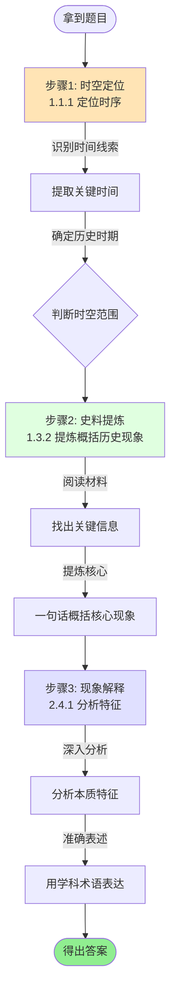
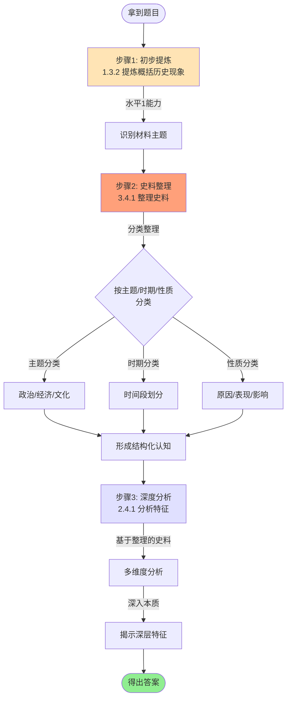
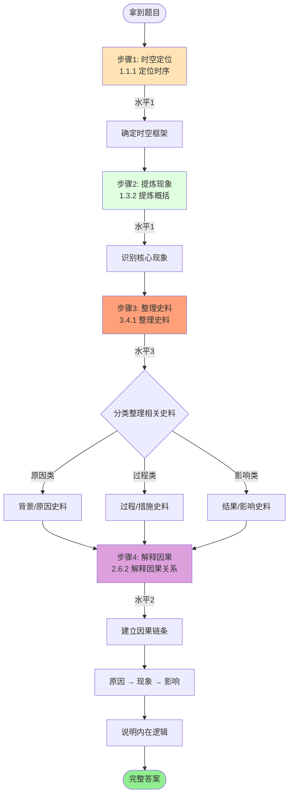
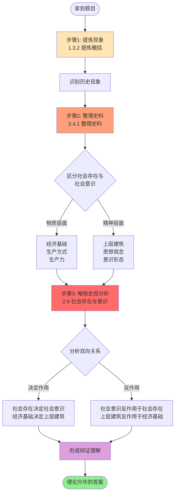
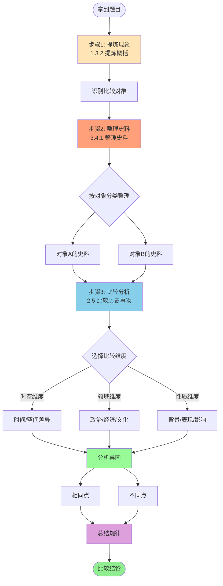
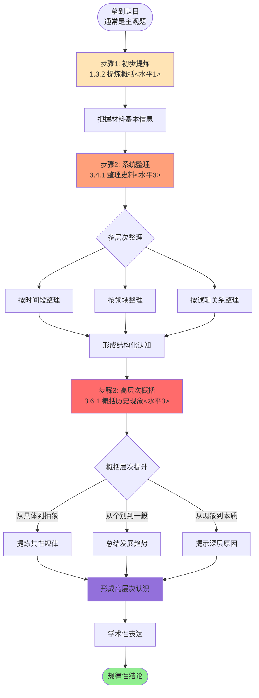
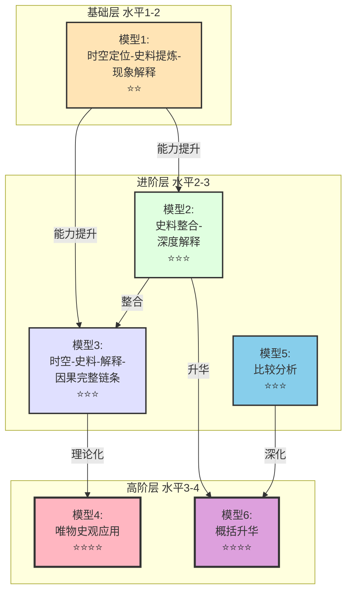

# 2025山东卷历史试题思维模型流程图

## 目录
- [模型1: 时空定位-史料提炼-现象解释模型](#模型1)
- [模型2: 史料整合-深度解释模型](#模型2)
- [模型3: 时空-史料-解释-因果完整链条模型](#模型3)
- [模型4: 唯物史观应用模型](#模型4)
- [模型5: 比较分析模型](#模型5)
- [模型6: 概括升华模型](#模型6)
- [模型关系总图](#总图)

---

<a name="模型1"></a>
## 【模型1】时空定位-史料提炼-现象解释模型

**使用场景**: 领袖讲话、思想论战、制度演变、文艺复兴作品分析
**难度等级**: ⭐⭐ (基础)
**出现频率**: 7次 (题号: 7, 10, 12, 13, 14, 15, 18)



**关键要点**:
1. **时空定位** (水平1): 快速识别"什么时候、什么地方"
2. **史料提炼** (水平1): 准确提炼"发生了什么"
3. **现象解释** (水平2): 深入分析"有什么特点"

**常见错误**:
- ❌ 时空定位不准确,理解偏差
- ❌ 提炼现象不全面,遗漏关键点
- ❌ 分析特征浮于表面,未触及本质

---

<a name="模型2"></a>
## 【模型2】史料整合-深度解释模型

**使用场景**: 图像史料分析、文本史料整合、多重史料综合、生活史料解读
**难度等级**: ⭐⭐⭐ (进阶)
**出现频率**: 8次 (题号: 7, 10, 11, 13, 14, 15, 16, 18)



**关键要点**:
1. **初步提炼** (水平1): 把握材料基本内容
2. **史料整理** (水平3): 系统分类、建立结构 ⚠️ **核心难点**
3. **深度分析** (水平2): 在整理基础上深入分析

**常见错误**:
- ❌ 史料整理混乱,未能分类
- ❌ 分析缺乏史料支撑
- ❌ 只见树木不见森林

**进阶技巧**:
- ✅ 用表格整理史料
- ✅ 按逻辑关系串联史料
- ✅ 抓住史料间的内在联系

---

<a name="模型3"></a>
## 【模型3】时空-史料-解释-因果完整链条模型

**使用场景**: 因果关系分析、政策变化解释、制度演变分析
**难度等级**: ⭐⭐⭐ (进阶)
**出现频率**: 5次 (题号: 7, 10, 14, 15, 18)



**关键要点**:
1. **时空定位** (水平1): 确定分析的时空范围
2. **提炼现象** (水平1): 明确要解释的对象
3. **整理史料** (水平3): 按因果逻辑分类整理
4. **解释因果** (水平2): 建立严密的因果链条

**因果分析框架**:
```
原因层面:
├─ 根本原因 (经济基础/生产力)
├─ 主要原因 (政治/思想)
└─ 直接原因 (导火索/契机)
     ↓
现象/事件
     ↓
影响层面:
├─ 直接影响
├─ 深远影响
└─ 历史地位
```

---

<a name="模型4"></a>
## 【模型4】唯物史观应用模型

**使用场景**: 思想观念分析、意识形态理解、社会变迁分析、艺术作品解读
**难度等级**: ⭐⭐⭐⭐ (高阶)
**出现频率**: 5次 (题号: 11, 13, 15, 18, 20)



**核心理论框架**:

```
【唯物史观核心原理】

1. 社会存在与社会意识的关系:
   社会存在 ←─────────→ 社会意识
        │    决定作用        ↑
        │                   │反作用
        └───────────────────┘

2. 生产力与生产关系的关系:
   生产力 ←─────────→ 生产关系
       │    决定作用      ↑
       │                 │反作用
       └─────────────────┘

3. 经济基础与上层建筑的关系:
   经济基础 ←─────────→ 上层建筑
         │    决定作用     ↑
         │                │反作用
         └────────────────┘
```

**关键要点**:
1. 识别材料中的"物质"与"精神"
2. 分析"决定"与"反作用"的双向关系
3. 用理论揭示现象本质

---

<a name="模型5"></a>
## 【模型5】比较分析模型

**使用场景**: 历史时期比较、中西对比、同类事物比较、长时段比较
**难度等级**: ⭐⭐⭐ (进阶)
**出现频率**: 4次 (题号: 10, 13, 14, 16)



**比较分析框架**:

```
【比较维度表】

对象      | 对象A         | 对象B         | 异同分析
---------|--------------|--------------|-------------
背景     | ...          | ...          | 相同点/不同点
表现/内容 | ...          | ...          | 相同点/不同点
特点     | ...          | ...          | 相同点/不同点
影响     | ...          | ...          | 相同点/不同点
历史地位  | ...          | ...          | 相同点/不同点
```

**关键要点**:
1. **明确比较对象**: 不能混淆比较对象
2. **选准比较维度**: 政治、经济、文化、时空等
3. **既看异又看同**: 相同点和不同点都要分析
4. **总结规律**: 从比较中发现规律

---

<a name="模型6"></a>
## 【模型6】概括升华模型

**使用场景**: 长时段规律总结、复杂现象概括、综合论述、历史小论文
**难度等级**: ⭐⭐⭐⭐ (高阶)
**出现频率**: 3次 (题号: 16, 18, 20)



**概括升华的层次**:

```
【三层概括法】

第一层:具体史实
├─ 时间、地点、人物、事件
└─ 材料中的具体信息

第二层:特征总结
├─ 提炼共同特点
└─ 归纳阶段特征

第三层:规律升华
├─ 揭示历史规律
├─ 总结发展趋势
└─ 提炼本质认识
```

**关键要点**:
1. **不停留于表面**: 要从具体上升到抽象
2. **寻找共性规律**: 从个别现象中找一般规律
3. **学术化表达**: 用历史学科术语准确表述
4. **逻辑严密**: 概括要有充分的史料支撑

---

<a name="总图"></a>
## 【六大思维模型关系总图】



### 模型能力层级对应表

| 模型 | 核心能力点 | 水平跨度 | 适用题型 | 掌握难度 |
|------|-----------|---------|---------|---------|
| 模型1 | 1.1.1 + 1.3.2 + 2.4.1 | 1→2 | 选择题为主 | 基础必掌握 |
| 模型2 | 1.3.2 + 3.4.1 + 2.4.1 | 1→3→2 | 选择题+简单主观题 | 进阶重点 |
| 模型3 | 1.1.1 + 1.3.2 + 3.4.1 + 2.6.2 | 1→3→2 | 因果分析题 | 进阶重点 |
| 模型4 | 1.3.2 + 3.4.1 + 2.9 | 1→3→2 | 思想观念题+主观题 | 高阶难点 |
| 模型5 | 1.3.2 + 3.4.1 + 2.5 | 1→3→2 | 比较题 | 进阶方法 |
| 模型6 | 1.3.2 + 3.4.1 + 3.6.1 | 1→3→3 | 主观题+小论文 | 高阶难点 |

### 模型组合应用策略

**简单选择题** (1-2分钟):
```
单一模型: 模型1
```

**中等难度选择题** (2-3分钟):
```
模型组合: 模型1 + 模型2
         或 模型1 + 模型5
```

**难度选择题** (3-4分钟):
```
模型组合: 模型1 + 模型2 + 模型4
```

**简单主观题** (5-8分钟):
```
模型组合: 模型2 + 模型3
```

**复杂主观题** (8-12分钟):
```
模型组合: 模型1 + 模型2 + 模型3 + 模型4
```

**历史小论文** (15-20分钟):
```
全模型整合:
├─ 模型1: 构建时空框架
├─ 模型2: 整理材料信息
├─ 模型3: 建立因果逻辑
├─ 模型4: 理论升华
├─ 模型5: 比较论证
└─ 模型6: 概括总结
```

---

## 模型训练路径建议

### 第一阶段: 基础模型训练 (1-2个月)
**目标**: 熟练掌握模型1
- 每天练习5-10道选择题
- 重点训练时空定位和现象提炼
- 形成基本的思维习惯

### 第二阶段: 进阶模型训练 (2-3个月)
**目标**: 掌握模型2、3、5
- 练习史料整理能力(模型2)
- 练习因果分析能力(模型3)
- 练习比较分析能力(模型5)
- 开始接触主观题

### 第三阶段: 高阶模型训练 (1-2个月)
**目标**: 掌握模型4、6
- 学习唯物史观基本原理(模型4)
- 练习高层次概括能力(模型6)
- 综合训练主观题和小论文

### 第四阶段: 模型组合训练 (持续)
**目标**: 灵活运用所有模型
- 根据题型自动选择模型
- 训练模型间的无缝衔接
- 形成完整的思维体系

---

**流程图说明**:
- 本文档使用Mermaid语法绘制流程图
- 在支持Mermaid的Markdown阅读器中可看到可视化图表
- 建议使用Typora、Obsidian或在线Mermaid编辑器查看

**更新日期**: 2026年1月5日
**数据来源**: 2025山东卷15题能力点分析
